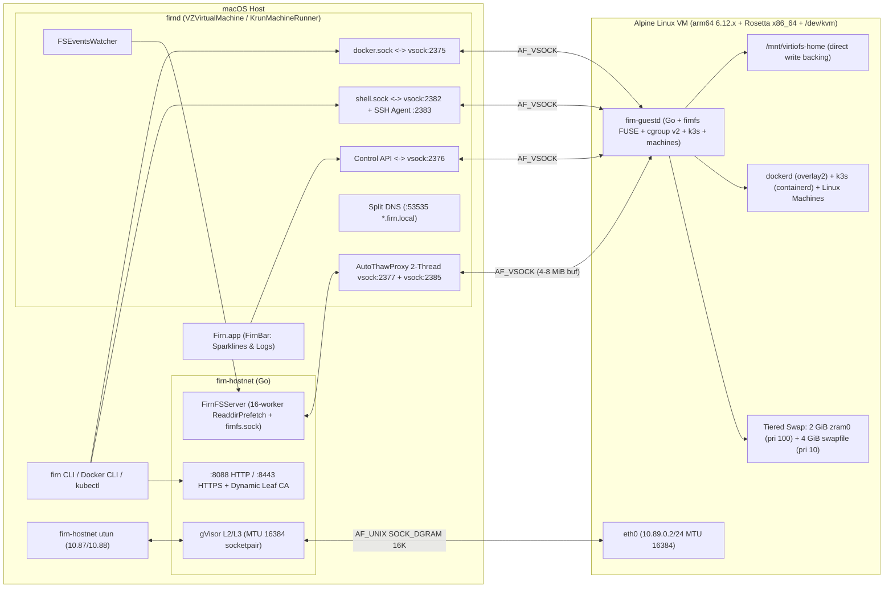

# Firn

[繁體中文](./README.zh-TW.md)

**Firn** is an open-source, lightweight macOS Docker, Kubernetes, and Linux VM runtime built natively in Swift and Go on Apple's `Virtualization.framework` (`VZVirtualMachine`), `virtio-vsock`, jumbo `virtio-net` (`MTU 16384`), hybrid `firnfs`, and Rosetta (`x86_64`).

It replaces heavy desktop VM helpers with **~1.5s guest boot / ~2.0s cold `firn up`**, **0.4% idle host CPU**, **~5,198 req/s HTTP/1.1 keep-alive** and **~969 MiB/s vsock TCP forwarding**, **`3.05 ms` local `:8443` HTTPS (`~2,982 req/s` conn/req)**, **`78 ms` 1,000-file bind-mount reads via `firnfs` + macOS `FSEvents` push invalidation**, **APFS VM state hibernation (`777 MiB -> 21.4 MiB`, `0 MiB` VM XPC footprint)**, **built-in `k3s` Kubernetes (`firn k8s`)**, **multi-distro Linux machines (`firn machine`)**, **optional `utun` direct container IP routing**, **opt-in `--nested-kvm` (`/dev/kvm`)**, **Metal/Vulkan GPU acceleration via `krunkit`**, and a **native Menu Bar app (`Firn.app`) with CoreGraphics sparklines & streaming logs**.

## Why Firn?

- **Zero VM footprint on hibernate & tiny idle draw**: Event-driven Docker `/events` long-polling keeps an awake VM at **0.4% CPU** (`761.6 MiB` footprint). Calling `firn hibernate` (or setting `FIRN_HIBERNATE_SECONDS`) saves VM state to APFS (`saveMachineStateTo`) and tears down the `VZVirtualMachine` XPC process—dropping host footprint from **`777.3 MiB` to `21.4 MiB` (`0 MiB` VM footprint)** while transparently resuming on the next `docker` or `*.firn.local` request.
- **`firnfs` fast host-shared reads + live macOS coherency**: Combines FUSE directory-prefetch (`OP_READDIR_PREFETCH` batched over `AF_VSOCK:2385`), a **64 MiB LRU cache**, and macOS **`FSEvents`** push invalidation (**`78.0 ms`** to read 1,000 files—`5.2×` faster than VirtioFS `407.2 ms`), while passing file creation/writes directly through `/mnt/virtiofs-home` (**`383.6 ms`** for 500 creates+writes+unlinks).
- **Multi-gigabit loopback & full-duplex `AF_VSOCK` splicing**: Dual-thread blocking `1 MiB` splicing with `8 MiB` `SO_VM_SOCKETS_BUFFER` windows delivers **`921–969 MiB/s`** raw TCP, **`0.136 ms` PostgreSQL `SELECT 1` RTT**, **`398 MiB/s` PG bulk queries**, and **`5,197.8 req/s`** HTTP/1.1 Keep-Alive.
- **Standalone Go `firn-hostnet` engine (zero `vmenet*` consumption)**: Uses a connected `AF_UNIX SOCK_DGRAM` `socketpair` with `MTU 16384` (`VZFileHandleNetworkDeviceAttachment`) + gVisor L2/L3 netstack and dynamic in-memory TLS leaf cert minting—cutting local `https://*.firn.local:8443` single-request latency from `104.4 ms` to **`3.05 ms` (`2,981.8 req/s`)** and lifting outbound container egress to **`1.81 MiB/s`** even on hosts with `251` `vmenet*` interfaces.
- **Built-in Kubernetes, Linux Machines, Nested KVM, `utun` & Metal GPU**: One-command `firn k8s enable` (`k3s v1.31.6+k3s1`, safe kubeconfig merge preserving existing `current-context`), persistent `firn machine` environments (`ubuntu`, `debian`, `alpine`, `arch`, `fedora`), opt-in `--nested-kvm` (`/dev/kvm`), non-conflicting `firn route` direct `10.87.0.0/24` + `10.88.0.0/16` routing, and optional `libkrun`/`krunkit` VirtIO-GPU Venus acceleration.

## Benchmarks (v0.4.0, Apple Silicon macOS)

Reproducible suite (`scripts/benchmark.py`) run on the same workstation (**Apple M5 Max**, 18-core CPU, 36.0 GiB RAM, macOS 27.2.1, Docker `29.8.2`, Compose `5.5.0`, `251` host `vmenet*` interfaces present):

```sh
python3 scripts/benchmark.py --contexts firn        # Benchmark Firn runtime
python3 scripts/benchmark.py --compare              # Side-by-side firn vs orbstack table
python3 scripts/benchmark.py --json                 # Full structured JSON report
```

> **Measurement context**: Firn `v0.4.0` was measured on the default tuned runtime (`firnfs`, `jumbo-16k`, `diskSync=none`, `nested_kvm=off`). Same-host `Firn v0.3.0` and `OrbStack` comparison columns come from the identical benchmark suite on the exact same M5 Max machine (while OrbStack also hosted 9 background Compose stacks / 62 containers; during v0.4.0 `top`, OrbStack Helper measured `60.8–171.3%` CPU and `1,696–4,441 MiB` RSS).

### Categories 1–6: Cross-Runtime Comparison

| Category | Metric | Firn v0.4.0 | Firn v0.3.0 | OrbStack (same-host ref) |
| --- | --- | --- | --- | --- |
| **1. Lifecycle & CLI** | `docker version` (5x median) | **`21.26 ms`** | `28.3 ms` | `22.5 ms` |
| | `docker run --rm alpine:3.21 true` (5x median) | **`379.75 ms`** | `401.1 ms` | `477.6 ms` |
| | `docker run --rm --entrypoint true postgres:18-alpine` (5x median) | `460.64 ms` | **`384.5 ms`** | `408.4 ms` |
| | 3-service Compose warm `up -d --wait` (`postgres` + `valkey` + `mailpit`) | `2,391.66 ms` | `2,627.1 ms` | **`2,072.9 ms`** |
| | 3-service Compose `down -v --remove-orphans` | `1,582.06 ms` | `4,422.3 ms` | **`825.5 ms`** |
| **2. Volume Disk I/O** | Sequential Write 256 MiB (`dd ... bs=1M count=256 conv=fsync`) | **`1,814.6 MiB/s`** (`141.1 ms`) | `709.8 MiB/s` (`360.7 ms`) | `1,724.3 MiB/s` (`148.5 ms`) |
| | Sequential Read 256 MiB (`dd`, page-cached post-write) | `3,728.4 MiB/s` (`68.7 ms`) | `3,949.5 MiB/s` (`64.8 ms`) | **`4,913.7 MiB/s`** (`52.1 ms`) |
| | Small-file burst (`1,000 × 4 KiB` create + write + `fsync` + unlink) | **`836.4 ms` (`1,195.6 ops/s`)** | `1,131.4 ms` (`883.8 ops/s`) | `1,654.9 ms` (`604.3 ops/s`) |
| **3. Host Shared FS** | 1,000-file tree walk (`find /work -type f`, cold / 3x median) | `849.5 ms` cold / `441.1 ms` med | `445.0 ms` cold / `472.1 ms` med | `587.9 ms` cold / **`393.9 ms` med** |
| | Read all 1,000 files (in-container / wall) | `78.0 ms` (`409.7 ms` wall) | `407.2 ms` (`891.9 ms` wall) | **`35.9 ms`** (`371.0 ms` wall) |
| | Create + write + remove `500 × 4 KiB` files (in-container / wall) | `383.6 ms` (`759.6 ms` wall) | `405.7 ms` (`822.6 ms` wall) | **`140.7 ms`** (`616.8 ms` wall) |
| **4. Host ↔ Container Net** | Raw TCP 128 MiB Host → Container | `921.4 MiB/s` (`138.9 ms`) | `418.3 MiB/s` (`306.0 ms`) | **`2,360.3 MiB/s`** (`54.2 ms`) |
| | Raw TCP 128 MiB Container → Host | `969.0 MiB/s` (`132.1 ms`) | `213.4 MiB/s` (`599.9 ms`) | **`4,172.3 MiB/s`** (`30.7 ms`) |
| | HTTP/1.1 Keep-Alive (500 req, c=16, Mailpit `/api/v1/info`) | **`5,197.8 req/s`** (`p50 2.63 ms`) | `2,514.0 req/s` (`p50 5.70 ms`) | `2,197.1 req/s` (`p50 6.07 ms`) |
| | HTTP/1.1 Conn-per-req (500 req, c=16, Mailpit `/api/v1/info`) | **`4,061.7 req/s`** (`p50 3.65 ms`) | `1,283.0 req/s` (`p50 10.21 ms`) | `2,506.7 req/s` (`p50 5.36 ms`) |
| | Local HTTPS `https://mailpit.<stack>.firn.local:8443/api/v1/info` | **`HTTP 200` (`3.05 ms`**, **`2,981.8 req/s`** `c=16`) | `HTTP 200` (`104.4 ms`) | — |
| | PostgreSQL `200x SELECT 1` RTT (avg / p50 / p95) | **`0.136 / 0.132 / 0.166 ms`** | `0.292 / 0.285 / 0.400 ms` | `0.179 / 0.156 / 0.346 ms` |
| | PostgreSQL `19.25 MiB` bulk query (`20,185 × 1,000 B`, 3x median) | **`398.3 MiB/s`** (`48.34 ms`) | `213.1 MiB/s` (`90.3 ms`) | `251.9 MiB/s` (`76.4 ms`) |
| **5. Outbound Egress** | Unproxied HTTPS inside `alpine:3.21` (`251` host `vmenet*` present) | **`HTTP 200`** (`1.81 MiB/s`, `0.258s`, jumbo `eth0`) | `HTTP 200` (`0.45 MiB/s`, `1.04s`) | **`HTTP 200`** (`1.83 MiB/s`, `0.25s`) |
| **6. Image Build** | `docker build --no-cache` (`FROM alpine:3.21`, 500 files) | **`338.07 ms`** | `464.5 ms` | `2,180.0 ms` (`6.4×` slower) |

### Category 7 & New v0.4.0 Capabilities

| Metric | Observed Result (v0.4.0) |
| --- | --- |
| Clean VM shutdown (`firn down`) | **`835.82 ms`** (`0.84s`) |
| Cold VM boot (`firn up` wall / guest `[firn-init] ready`) | **`1,998.22 ms`** wall (`1,703.3 ms` daemon) / **`1.49s`** guest uptime |
| Idle host usage (`top`, 0 containers) | **`0.4%` CPU**, **`761.6 MiB`** footprint (`firnd 29.0 MiB` + `VM 732.6 MiB`) |
| Hibernate (`firn hibernate`, APFS `saveMachineStateTo`) | **`777.3 MiB → 21.4 MiB`** host footprint (**`0 MiB` VM XPC**), `176.0 MiB` state, transparent wake on `docker ps` |
| 3 simultaneous stacks (`valkey` + `mailpit`, 6 containers) active RAM | `96.35 MiB` (`zram0` `0.02 MiB`) |
| Freeze & reclaim all 3 stacks (`firn freeze <stack> --reclaim`) | `96.35 MiB → 16.49 MiB` (**`82.9%` reclaimed**; `45.02 MiB` swap → **`4.98 MiB`** in `zram0`, `1.5%` CPU) |
| Target-first Auto-Thaw (Valkey `PING` / HTTPS `:8443` from frozen) | **`55.46 ms` TCP** / **`34.58 ms` HTTPS** (`pausedCount = 0`; `guestThaw = 25.55 ms`, `hostThaw = 26.85 ms`) |
| Built-in Kubernetes (`firn k8s enable`) | `k3s v1.31.6+k3s1` `Ready` on `127.0.0.1:6443` (preserves existing `kubectl` `current-context`) |
| Multi-distro Linux Machines (`firn machine create testbox --distro alpine`) | Assigned `10.87.0.2` + `testbox.firn.local`, interactive PTY `shell`, shared `$HOME` |
| Opt-in Nested KVM (`firn up --nested-kvm`) | Exposes `/dev/kvm` (`crw-rw-rw- 1 root kvm`) inside guest |

## Architecture



## Prerequisites

- Apple Silicon (or Intel) Mac running macOS 14+ (`macOS 15+` for `--nested-kvm`) with `Virtualization.framework`
- Xcode Command Line Tools (`swift`)
- Go toolchain matching `guest/firn-guestd/go.mod` and `host/firn-hostnet/go.mod`
- Docker CLI + Compose v2 (`docker`) plus a builder Docker context for `make rootfs` (`BUILD_DOCKER_CONTEXT`)
- Optional: `kubectl` (for `firn k8s`) and `krunkit` (`brew tap libkrun/krun && brew install krunkit`, for `--backend krun --gpu` Metal/Venus Vulkan acceleration)

## Quick Start

```sh
# Build Alpine kernel/rootfs, firn-guestd, firn-hostnet, firn CLI, firnd daemon, and Firn.app
make build

# Start Firn VM (registers 'firn' Docker context without overwriting your default context)
build/firn up

# Run containers, Linux machines, or single-node Kubernetes against Firn
docker --context firn ps
build/firn machine create dev --distro ubuntu && build/firn machine shell dev
build/firn k8s enable && kubectl --context firn get nodes

# Switch default Docker context safely (restorable via `firn context restore`)
build/firn context use
```

## CLI Reference

| Command | Description |
| --- | --- |
| `firn up [--cpus N] [--memory-gib N] [--context NAME] [--backend vz\|krun] [--fs firnfs\|virtiofs] [--disk-sync none\|fsync] [--gpu] [--nested-kvm]` | Boot or wake VM, sync config/proxies, and register Docker context |
| `firn down` | Request clean guest poweroff (`k3s`, `fstrim`, swapoff, ro remount) and stop `firnd` |
| `firn hibernate [--json]` | Save VM state to APFS (`vm-state.vzvmsave`) or park VM, dropping VM XPC memory to `0 MiB` |
| `firn resume [--json]` | Restore hibernated VM immediately (`firn` also wakes automatically on traffic) |
| `firn status [--json]` | Show guest/host memory, CPU%, capabilities, APFS disk, DNS/HTTPS, route, and stacks |
| `firn shell [-- COMMAND...]` | Open interactive PTY shell (`vsock:2382`) with `SSH_AUTH_SOCK` forwarding |
| `firn k8s <status\|enable [--no-kubeconfig] [--use]\|disable\|reset\|freeze\|thaw\|kubeconfig>` | Manage built-in `k3s` Kubernetes cluster with non-destructive kubeconfig merge |
| `firn machine <list\|create <name> [--distro D]\|shell <name>\|start\|stop\|delete>` | Manage persistent Ubuntu/Debian/Alpine/Arch/Fedora machines sharing `$HOME` |
| `firn route <status\|up\|install [--dns]\|uninstall\|dns <status\|on\|off>>` | Manage host `utun` direct routing to container subnets (`10.87.0.0/24`, `10.88.0.0/16`) |
| `firn freeze <project> [--reclaim]` | Freeze Compose stack (`cgroup.freeze`) and reclaim RAM + drop caches |
| `firn thaw <project>` | Unpause a frozen Compose stack (auto-thaws on traffic) |
| `firn reclaim [project]` | Reclaim cold container pages without manual pause |
| `firn balloon <shrink\|reset>` | Shrink memory balloon to guest demand or reset to `maxMemoryBytes` |
| `firn disk <usage\|trim> [--json]` | Inspect APFS sparse disk + `zram0` usage or run online `fstrim` |
| `firn dns <status\|install\|uninstall>` | Inspect DNS records or install/remove `/etc/resolver/<domain>` (`sudo`) |
| `firn ca <status\|install\|uninstall>` | Inspect Firn Root CA or trust/untrust in macOS System Keychain (`sudo`) |
| `firn https <status\|install\|uninstall>` | Inspect `:8443` TLS proxy or manage `:80`/`:443` `pf` anchor (`sudo`) |
| `firn context <status\|use\|restore>` | Show, switch to, or restore your previous default Docker context |
| `firn proxy` | Show detected macOS HTTP/HTTPS proxy, VPN, DNS, and `SSH_AUTH_SOCK` relay state |
| `firn gui` | Launch `build/Firn.app` (`FirnBar`) menu bar monitor with sparklines & log viewer |
| `firn doctor` | Diagnose Hypervisor, Nested KVM, Metal GPU/`krunkit`, `firn-hostnet`, `k3s`, CA, DNS, `pf`, and disk |
| `firn autostart <status\|install\|uninstall>` | Manage optional user LaunchAgent (`~/Library/LaunchAgents/dev.firn.firnd.plist`) |
| `firn upgrade [--check] [--version vX.Y.Z]` | Check or install verified GitHub Release updates with SHA-256 verification |
| `firn bench [--project NAME] [--compare-orbstack]` | Benchmark freeze/reclaim and thaw latency |
| `firn logs [--serial\|--daemon\|--hostnet]` | Tail VM serial console, `firnd`, or `firn-hostnet` logs |

## Local Domains & HTTPS (`*.firn.local`)

Every Compose container with exposed TCP ports (and every `firn machine`) gets automatic DNS records (`<container>.firn.local`, `<service>.<project>.firn.local`):

1. Optional macOS split DNS: `sudo build/firn dns install`
2. Optional trusted local HTTPS (`https://<service>.<project>.firn.local:8443`): `sudo build/firn ca install`
3. Optional zero-port `http://` and `https://` (`:80` / `:443` `pf` redirect): `sudo build/firn https install`

## Compose Labels & Configuration

```yaml
services:
  postgres:
    image: postgres:18-alpine
    labels:
      - "firn.reaper.exempt=true"   # Never auto-freeze this Compose project

  worker:
    labels:
      - "firn.reaper.idle=300"      # Override idle timeout (seconds; "0" disables freeze)
```

Global settings live in `~/.firn/config.json` (editable via `FirnBar` → **Settings…**) and can be overridden with environment variables:

- `FIRN_HOME` (default `~/.firn`), `FIRN_CONTEXT` (default `firn`)
- `FIRN_CPUS` (default `8`), `FIRN_MEMORY_GIB` (default `8`), `FIRN_MIN_BALLOON_MIB` (default `768`)
- `FIRN_DISK_SYNC` (`none` default or `fsync`), `FIRN_FS_MODE` (`firnfs` default or `virtiofs`)
- `FIRN_BACKEND` (`vz` default or `krun`), `FIRN_GPU` (`false` default), `FIRN_NESTED_VIRT` (`false` default)
- `FIRN_HIBERNATE_SECONDS` (`0` disables auto-hibernate), `FIRN_IDLE_SECONDS` (`900`), `FIRN_EXEMPT_PROJECTS`
- `FIRN_DOMAIN` (`firn.local`), `FIRN_DNS_PORT` (`53535`), `FIRN_HTTP_PROXY_PORT` (`8088`), `FIRN_HTTPS_PROXY_PORT` (`8443`), `FIRN_DIRECT_ROUTE_DNS` (`false`)
- `BUILD_DOCKER_CONTEXT` (Docker context used by `make build` / `guest/build-rootfs.sh`)

## Packaging & Homebrew

A Homebrew formula is provided at [packaging/homebrew/firn.rb](./packaging/homebrew/firn.rb), and multi-job CI/release workflows live under [.github/workflows/ci.yml](./.github/workflows/ci.yml) and [.github/workflows/release.yml](./.github/workflows/release.yml).

## Contributing & License

See [CONTRIBUTING.md](./CONTRIBUTING.md) and [SECURITY.md](./SECURITY.md). Licensed under the [Apache License 2.0](./LICENSE).
