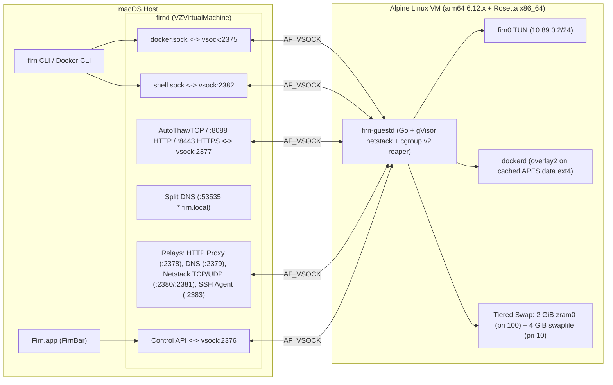

# Firn

[繁體中文](./README.zh-TW.md)

**Firn** is an open-source, lightweight macOS Docker Linux VM runtime built natively in Swift and Go on Apple's `Virtualization.framework` (`VZVirtualMachine`), `virtio-vsock`, `virtiofs`, and Rosetta (`x86_64`).

It replaces heavy desktop VM helpers with sub-2-second cold boot, ~0.5% idle host CPU, near-gigabyte-per-second vsock TCP forwarding, **vsock user-space L3/L4 container networking** (immune to macOS `vmenet` exhaustion and corporate VPNs), **cgroup v2 idle freezing + zram-backed reclaim**, **17 ms target-first Auto-Thaw**, **`https://*.firn.local`** TLS domains, an interactive **`firn shell`**, and a native **Menu Bar app (`Firn.app`)**.

## Why Firn?

- **Zero background churn**: Event-driven Docker `/events` long-polling keeps `firnd` at **0.0% CPU** and the VM around **0.5% CPU** when idle.
- **Keep 10+ worktree stacks alive effortlessly**: Idle Compose projects are paused via cgroup v2 `cgroup.freeze`, cold pages are reclaimed to in-memory `zram` + swapfile (`~98%` container RAM reduction), and the moment any TCP/HTTP/HTTPS request hits a published port or `*.firn.local` domain, the targeted container thaws automatically in milliseconds.
- **Container internet that works on macOS VPNs & `vmenet`-exhausted hosts**: Instead of relying solely on `vmnet` (`eth0`), `firn-guestd` attaches a `firn0` TUN device to a gVisor user-space TCP/UDP netstack routed over `AF_VSOCK` straight through macOS host sockets.
- **High-throughput loopback port forwarding**: 256 KiB non-blocking `poll()` vsock splicing with 1 MiB socket buffers and dual-stack (`127.0.0.1` + `[::1]`) listeners.
- **Local HTTPS & SSH agent forwarding built in**: Built-in per-machine Root CA + `Network.framework` TLS reverse proxy (`:8443`), plus automatic host `SSH_AUTH_SOCK` forwarding (`firn shell` and `docker build`).

## Benchmarks (v0.3.0, Apple Silicon macOS)

Measured on the same Apple Silicon workstation running a 6-container local development stack (`PostgreSQL 18`, `Valkey/Redis`, `Qdrant`, `SpiceDB`, `SeaweedFS`, `Mailpit`):

| Metric | Firn v0.3.0 | Commercial Desktop VM (Same Host) |
| --- | --- | --- |
| Guest cold boot (`[firn-init] ready`) | **`1.73s`** (`1.17s` first boot) | — |
| Idle host CPU (`top`, 0 containers) | **`0.5%`** (`firnd 0.0%` + VM `0.5%`) | **`96.5%`** (9 projects / 62 containers) |
| Idle host helper RSS | **`~503–994 MiB`** (VM + daemon) | **`4,194.8 MiB`** (helper only) |
| `docker run --rm --entrypoint true postgres:18-alpine` (3x median) | **`370.3 ms`** | `657.1 ms` |
| VirtioFS directory walk (240 files, 3x median) | **`357.9 ms`** | `626.0 ms` |
| PostgreSQL `200x SELECT 1` TCP RTT avg | **`0.141 ms`** (`p50 0.134 ms`) | `0.182 ms` |
| PostgreSQL `19.25 MiB` bulk query throughput (median) | **`896.4 MiB/s`** (`21.5 ms`) | `164.6 MiB/s` (`118.6 ms`) |
| Stack freeze + memory reclaim (`firn freeze --reclaim`) | `602.8 MB → 11.3 MB` (**98.1% reclaimed**) | — |
| Target-first Auto-Thaw (`127.0.0.1` Redis `PING` from frozen) | **`17.3 ms`** (`24.97 ms` thaw RTT) | — |
| HTTPS Auto-Thaw (`https://*.firn.local:8443`) | **`0.281s` (HTTP 200)** | — |
| Unproxied container HTTPS egress (with 251 `vmenet*` present) | **`HTTP/2 200`** (`firn0` vsock netstack) | — |

## Architecture



## Prerequisites

- Apple Silicon (or Intel) Mac running macOS 14+ with `Virtualization.framework`
- Xcode Command Line Tools (`swift`)
- Go toolchain matching `guest/firn-guestd/go.mod` (`linux/arm64` cross-compilation)
- Docker CLI + Compose v2 (`docker`) plus an existing Docker builder context for initial Alpine rootfs assembly (`BUILD_DOCKER_CONTEXT`)

## Quick Start

```sh
# Build Alpine kernel/rootfs, firn-guestd, firn CLI, firnd daemon, and Firn.app
make build

# Start Firn VM (registers 'firn' Docker context without overwriting your default context)
build/firn up

# Run containers explicitly against Firn
docker --context firn ps

# Or switch your default context safely (restorable via `firn context restore`)
build/firn context use

# Verify container internet egress over vsock netstack + enter interactive guest shell
docker --context firn run --rm alpine:3.21 sh -c 'apk update && apk add curl && curl -I https://example.com'
build/firn shell
```

## CLI Reference

| Command | Description |
| --- | --- |
| `firn up [--cpus N] [--memory-gib N] [--context NAME]` | Boot VM, push config, start proxies, and configure Docker context |
| `firn down` | Request clean guest poweroff (`fstrim`, swapoff, read-only remount) and stop `firnd` |
| `firn status [--json]` | Show guest/host memory, APFS sparse disk usage, DNS/HTTPS status, and stacks |
| `firn shell [-- COMMAND...]` | Open interactive PTY shell (`vsock:2382`) with `SSH_AUTH_SOCK` forwarding |
| `firn freeze <project> [--reclaim]` | Freeze Compose stack (`cgroup.freeze`) and optionally reclaim RAM + drop caches |
| `firn thaw <project>` | Unpause a frozen Compose stack (`firn` also thaws automatically on traffic) |
| `firn reclaim [project]` | Reclaim cold container pages without manual pause |
| `firn balloon <shrink\|reset>` | Shrink memory balloon to guest demand or reset to `maxMemoryBytes` |
| `firn disk <usage\|trim> [--json]` | Inspect APFS sparse disk + `zram0` usage or run online `fstrim` |
| `firn dns <status\|install\|uninstall>` | Inspect DNS records or install/remove `/etc/resolver/<domain>` (`sudo`) |
| `firn ca <status\|install\|uninstall>` | Inspect Firn Root CA or trust/untrust in macOS System Keychain (`sudo`) |
| `firn https <status\|install\|uninstall>` | Inspect `:8443` TLS proxy or manage `:80`/`:443` `pf` anchor (`sudo`) |
| `firn context <status\|use\|restore>` | Show, switch to, or restore your previous default Docker context |
| `firn proxy` | Show detected macOS HTTP/HTTPS proxy, VPN, DNS, and `SSH_AUTH_SOCK` relay state |
| `firn gui` | Launch `build/Firn.app` (`FirnBar`) menu bar monitor |
| `firn doctor` | Run diagnostics for Hypervisor, Rosetta, entitlement, CA, DNS, `pf`, and disk |
| `firn autostart <status\|install\|uninstall>` | Manage optional user LaunchAgent (`~/Library/LaunchAgents/dev.firn.firnd.plist`) |
| `firn bench [--project NAME] [--compare-orbstack]` | Benchmark freeze/reclaim and thaw latency (optionally comparing host helper RSS/CPU) |
| `firn logs [--serial\|--daemon]` | Tail VM serial console or host daemon logs |

## Local Domains & HTTPS (`*.firn.local`)

Every Compose container with exposed TCP ports gets automatic DNS records:
- `<container>.firn.local`
- `<service>.<project>.firn.local` (plus `mail.<project>.firn.local` for `mailpit`)

1. Optional macOS split DNS: `sudo build/firn dns install`
2. Optional trusted local HTTPS (`https://<service>.<project>.firn.local:8443`):
   ```sh
   sudo build/firn ca install
   ```
3. Optional zero-port `http://` and `https://` (`:80` / `:443` loopback redirect via `pf`):
   ```sh
   sudo build/firn https install
   ```

## Compose Labels & Configuration

Control per-project idle reaping directly in `docker-compose.yml`:

```yaml
services:
  postgres:
    image: postgres:18-alpine
    labels:
      - "firn.reaper.exempt=true"   # Never auto-freeze this Compose project

  worker:
    labels:
      - "firn.reaper.idle=300"      # Override idle timeout (seconds; "0" disables freeze)
```

Global settings live in `~/.firn/config.json` (editable via `FirnBar` → **Settings…**) and can be overridden with environment variables:

- `FIRN_HOME` (default `~/.firn`)
- `FIRN_CONTEXT` (default `firn`)
- `FIRN_CPUS` (default `8`)
- `FIRN_MEMORY_GIB` (default `8`)
- `FIRN_MIN_BALLOON_MIB` (default `768`)
- `FIRN_DOMAIN` (default `firn.local`)
- `FIRN_DNS_PORT` (default `53535`)
- `FIRN_HTTP_PROXY_PORT` (default `8088`)
- `FIRN_HTTPS_PROXY_PORT` (default `8443`)
- `FIRN_IDLE_SECONDS` (default `900`, `0` disables global idle freeze)
- `FIRN_EXEMPT_PROJECTS` (comma-separated Compose project names, default empty)
- `BUILD_DOCKER_CONTEXT` (Docker context used by `make build` / `guest/build-rootfs.sh`)

## Contributing & License

See [CONTRIBUTING.md](./CONTRIBUTING.md) and [SECURITY.md](./SECURITY.md). Licensed under the [Apache License 2.0](./LICENSE).
