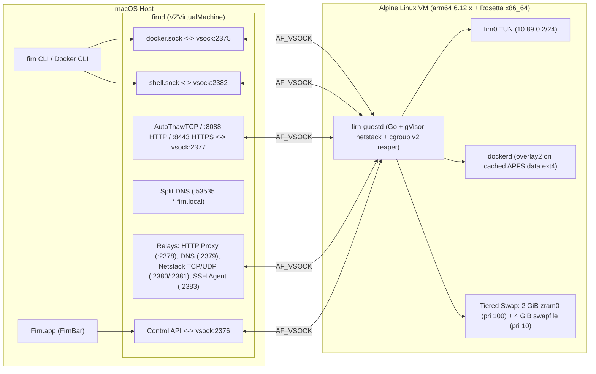

# Firn

[繁體中文](./README.zh-TW.md)

**Firn** is an open-source, lightweight macOS Docker Linux VM runtime built natively in Swift and Go on Apple's `Virtualization.framework` (`VZVirtualMachine`), `virtio-vsock`, `virtiofs`, and Rosetta (`x86_64`).

It replaces heavy desktop VM helpers with ~2.2s guest boot (~2.8s cold `firn up`), **0.3% idle host CPU**, **~2.5k req/s HTTP/1.1 keep-alive** and high-speed vsock TCP forwarding, **vsock user-space L3/L4 container networking** (immune to macOS `vmenet` exhaustion and corporate VPNs), **cgroup v2 idle freezing + zram-backed reclaim**, **~29 ms TCP / ~88 ms HTTPS target-first Auto-Thaw**, **`https://*.firn.local`** TLS domains, an interactive **`firn shell`**, and a native **Menu Bar app (`Firn.app`)**.

## Why Firn?

- **Zero background churn**: Event-driven Docker `/events` long-polling keeps `firnd` and the VM at **0.3% host CPU** (`~569 MiB` RSS) when idle with zero containers.
- **Keep 10+ worktree stacks alive effortlessly**: Idle Compose projects are paused via cgroup v2 `cgroup.freeze`, cold pages are reclaimed to in-memory `zram` + swapfile (`80–98%` container RAM reduction with `~8.8×` zram compression), and the moment any TCP/HTTP/HTTPS request hits a published port or `*.firn.local` domain, the targeted container thaws automatically in milliseconds.
- **Container internet that works on macOS VPNs & `vmenet`-exhausted hosts**: Instead of relying solely on `vmnet` (`eth0`), `firn-guestd` attaches a `firn0` TUN device to a gVisor user-space TCP/UDP netstack routed over `AF_VSOCK` straight through macOS host sockets.
- **High-throughput loopback port forwarding**: 256 KiB non-blocking `poll()` vsock splicing with 1 MiB socket buffers and dual-stack (`127.0.0.1` + `[::1]`) listeners.
- **Local HTTPS & SSH agent forwarding built in**: Built-in per-machine Root CA + `Network.framework` TLS reverse proxy (`:8443`), plus automatic host `SSH_AUTH_SOCK` forwarding (`firn shell` and `docker build`).

## Benchmarks (v0.3.0, Apple Silicon macOS)

Apples-to-apples reproducible suite comparing **Firn v0.3.0** and **OrbStack** on the same workstation (**Apple M5 Max**, 18-core CPU, 36.0 GiB RAM, macOS 27.2.1, Docker `29.8.2`, Compose `5.5.0`, `251` host `vmenet*` interfaces present).

Reproduce on your own Mac (uses only Python 3 stdlib + a temporary static Go micro-helper if Go is present, binds ephemeral loopback ports, and cleans up all `firn-bench-*` resources without touching existing containers or your default `docker context`):

```sh
python3 scripts/benchmark.py            # Side-by-side summary table (--compare)
python3 scripts/benchmark.py --json     # Full structured JSON report
```

> **Measurement context**: During this run, OrbStack also hosted 9 pre-existing background Compose stacks (62 running containers; `OrbStack Helper` measured `3,388–7,395 MiB` RSS and `118–180%` CPU). Firn ran Categories 1–6 with 0 background projects and Category 7 with 3 dedicated 2-container stacks.

### Categories 1–6: Cross-Runtime Comparison

| Category | Metric | Firn v0.3.0 | OrbStack |
| --- | --- | --- | --- |
| **1. Lifecycle & CLI** | `docker version` (5x median) | `28.3 ms` | **`22.5 ms`** |
| | `docker run --rm alpine:3.21 true` (5x median) | **`401.1 ms`** | `477.6 ms` |
| | `docker run --rm --entrypoint true postgres:18-alpine` (5x median) | **`384.5 ms`** | `408.4 ms` |
| | 3-service Compose warm `up -d --wait` (`postgres` + `valkey` + `mailpit`) | `2,627.1 ms` | **`2,072.9 ms`** |
| | 3-service Compose `down -v --remove-orphans` | `4,422.3 ms` | **`825.5 ms`** |
| **2. Volume Disk I/O** | Sequential Write 256 MiB (`dd ... bs=1M count=256 conv=fsync`) | `709.8 MiB/s` (`360.7 ms`) | **`1,724.3 MiB/s`** (`148.5 ms`) |
| | Sequential Read 256 MiB (`dd`, page-cached post-write) | `3,949.5 MiB/s` (`64.8 ms`) | **`4,913.7 MiB/s`** (`52.1 ms`) |
| | Small-file burst (`1,000 × 4 KiB` create + write + `fsync` + unlink) | **`1,131.4 ms` (`883.8 ops/s`)** | `1,654.9 ms` (`604.3 ops/s`) |
| **3. Bind Mount / VirtioFS** | 1,000-file tree walk (`find /work -type f`, cold / 3x median) | **`445.0 ms` cold** / `472.1 ms` med | `587.9 ms` cold / **`393.9 ms` med** |
| | Read all 1,000 files (in-container / wall) | `407.2 ms` (`891.9 ms` wall) | **`35.9 ms`** (`371.0 ms` wall) |
| | Create + write + remove `500 × 4 KiB` files (in-container / wall) | `405.7 ms` (`822.6 ms` wall) | **`140.7 ms`** (`616.8 ms` wall) |
| **4. Host ↔ Container Net** | Raw TCP 128 MiB Host → Container | `418.3 MiB/s` (`306.0 ms`) | **`2,360.3 MiB/s`** (`54.2 ms`) |
| | Raw TCP 128 MiB Container → Host | `213.4 MiB/s` (`599.9 ms`) | **`4,172.3 MiB/s`** (`30.7 ms`) |
| | HTTP/1.1 Keep-Alive (500 req, c=16, Mailpit `/api/v1/info`) | **`2,514.0 req/s`** (`p50 5.70 ms`) | `2,197.1 req/s` (`p50 6.07 ms`) |
| | HTTP/1.1 Conn-per-req (500 req, c=16, Mailpit `/api/v1/info`) | `1,283.0 req/s` (`p50 10.21 ms`) | **`2,506.7 req/s`** (`p50 5.36 ms`) |
| | Local HTTPS `https://mailpit.<stack>.firn.local:8443/api/v1/info` (`curl`) | **`HTTP 200` (`104.4 ms`)** | — |
| | PostgreSQL `200x SELECT 1` RTT (avg / p50 / p95) | `0.292 / 0.285 / 0.400 ms` | **`0.179 / 0.156 / 0.346 ms`** |
| | PostgreSQL `19.25 MiB` bulk query (`20,185 × 1,000 B`, 3x median) | `213.1 MiB/s` (`90.3 ms`) | **`251.9 MiB/s`** (`76.4 ms`) |
| **5. Outbound Egress** | Unproxied HTTPS inside `alpine:3.21` (`251` host `vmenet*` present) | **`HTTP 200`** (`0.45 MiB/s`, `1.04s`, `firn0`) | **`HTTP 200`** (`1.83 MiB/s`, `0.25s`) |
| **6. Image Build** | `docker build --no-cache` (`FROM alpine:3.21`, 500 files) | **`464.5 ms`** | `2,180.0 ms` (`4.7×` slower) |

### Category 7: Firn VM Lifecycle, Multi-Stack Reclaim & Auto-Thaw

| Metric | Observed Result |
| --- | --- |
| Clean VM shutdown (`firn down`) | **`1,074.4 ms`** (`1.07s`) |
| Clean VM cold boot (`firn up` wall / guest `[firn-init] ready`) | **`2,832.0 ms`** wall (`2,532.5 ms` daemon) / **`2.19s`** guest uptime |
| Idle host usage (`top -l 2 -s 5`, 0 containers) | **`0.3%` CPU**, **`769.6 MiB`** footprint (`firnd 23.9 MiB` + `VM 745.7 MiB`), **`569.2 MiB`** RSS |
| Same-host OrbStack snapshot (9 projects / 62 containers) | Helper **`118.1–180.3%` CPU**, **`3,388.2–7,395.4 MiB` RSS** |
| 3 simultaneous stacks (`valkey:9.1.3-alpine` + `mailpit:v1.31.0`, 6 containers) active RAM | `95.99 MiB` (`zram0` `0.02 MiB`) |
| Freeze & reclaim all 3 stacks (`firn freeze <stack> --reclaim`) | `95.99 MiB → 19.24 MiB` (**`80.0%` reclaimed**; `42.20 MiB` swap → **`4.78 MiB`** in `zram0`, `0.6%` host CPU) |
| Target-first TCP Auto-Thaw (Valkey `PING` → `+PONG` from frozen) | **`28.75 ms`** (`pausedCount` confirmed `0`) |
| HTTPS Auto-Thaw (`https://mailpit.<stack>.firn.local:8443/` from frozen) | **`88.17 ms`** (`HTTP 200`, `pausedCount` confirmed `0`) |
| `firn bench --project <stack> --compare-orbstack` | Freeze `100.32 ms`, guest thaw `41.21 ms`, host thaw RTT `42.81 ms`, balloon `8.00 GiB → 1.23 GiB` |

## Architecture



## Prerequisites

- Apple Silicon (or Intel) Mac running macOS 14+ with `Virtualization.framework`
- Xcode Command Line Tools (`swift`)
- Go toolchain matching `guest/firn-guestd/go.mod` (`linux/arm64` cross-compilation)
- Docker CLI + Compose v2 (`docker`) plus an existing Docker builder context for initial Alpine rootfs assembly (`BUILD_DOCKER_CONTEXT`)

## Quick Start

```sh
# Build Alpine kernel/rootfs, firn-guestd, firn CLI, firnd daemon, and Firn.app
make build

# Start Firn VM (registers 'firn' Docker context without overwriting your default context)
build/firn up

# Run containers explicitly against Firn
docker --context firn ps

# Or switch your default context safely (restorable via `firn context restore`)
build/firn context use

# Verify container internet egress over vsock netstack + enter interactive guest shell
docker --context firn run --rm alpine:3.21 sh -c 'apk update && apk add curl && curl -I https://example.com'
build/firn shell
```

## CLI Reference

| Command | Description |
| --- | --- |
| `firn up [--cpus N] [--memory-gib N] [--context NAME]` | Boot VM, push config, start proxies, and configure Docker context |
| `firn down` | Request clean guest poweroff (`fstrim`, swapoff, read-only remount) and stop `firnd` |
| `firn status [--json]` | Show guest/host memory, APFS sparse disk usage, DNS/HTTPS status, and stacks |
| `firn shell [-- COMMAND...]` | Open interactive PTY shell (`vsock:2382`) with `SSH_AUTH_SOCK` forwarding |
| `firn freeze <project> [--reclaim]` | Freeze Compose stack (`cgroup.freeze`) and optionally reclaim RAM + drop caches |
| `firn thaw <project>` | Unpause a frozen Compose stack (`firn` also thaws automatically on traffic) |
| `firn reclaim [project]` | Reclaim cold container pages without manual pause |
| `firn balloon <shrink\|reset>` | Shrink memory balloon to guest demand or reset to `maxMemoryBytes` |
| `firn disk <usage\|trim> [--json]` | Inspect APFS sparse disk + `zram0` usage or run online `fstrim` |
| `firn dns <status\|install\|uninstall>` | Inspect DNS records or install/remove `/etc/resolver/<domain>` (`sudo`) |
| `firn ca <status\|install\|uninstall>` | Inspect Firn Root CA or trust/untrust in macOS System Keychain (`sudo`) |
| `firn https <status\|install\|uninstall>` | Inspect `:8443` TLS proxy or manage `:80`/`:443` `pf` anchor (`sudo`) |
| `firn context <status\|use\|restore>` | Show, switch to, or restore your previous default Docker context |
| `firn proxy` | Show detected macOS HTTP/HTTPS proxy, VPN, DNS, and `SSH_AUTH_SOCK` relay state |
| `firn gui` | Launch `build/Firn.app` (`FirnBar`) menu bar monitor |
| `firn doctor` | Run diagnostics for Hypervisor, Rosetta, entitlement, CA, DNS, `pf`, and disk |
| `firn autostart <status\|install\|uninstall>` | Manage optional user LaunchAgent (`~/Library/LaunchAgents/dev.firn.firnd.plist`) |
| `firn bench [--project NAME] [--compare-orbstack]` | Benchmark freeze/reclaim and thaw latency (optionally comparing host helper RSS/CPU) |
| `firn logs [--serial\|--daemon]` | Tail VM serial console or host daemon logs |

## Local Domains & HTTPS (`*.firn.local`)

Every Compose container with exposed TCP ports gets automatic DNS records:
- `<container>.firn.local`
- `<service>.<project>.firn.local` (plus `mail.<project>.firn.local` for `mailpit`)

1. Optional macOS split DNS: `sudo build/firn dns install`
2. Optional trusted local HTTPS (`https://<service>.<project>.firn.local:8443`):
   ```sh
   sudo build/firn ca install
   ```
3. Optional zero-port `http://` and `https://` (`:80` / `:443` loopback redirect via `pf`):
   ```sh
   sudo build/firn https install
   ```

## Compose Labels & Configuration

Control per-project idle reaping directly in `docker-compose.yml`:

```yaml
services:
  postgres:
    image: postgres:18-alpine
    labels:
      - "firn.reaper.exempt=true"   # Never auto-freeze this Compose project

  worker:
    labels:
      - "firn.reaper.idle=300"      # Override idle timeout (seconds; "0" disables freeze)
```

Global settings live in `~/.firn/config.json` (editable via `FirnBar` → **Settings…**) and can be overridden with environment variables:

- `FIRN_HOME` (default `~/.firn`)
- `FIRN_CONTEXT` (default `firn`)
- `FIRN_CPUS` (default `8`)
- `FIRN_MEMORY_GIB` (default `8`)
- `FIRN_MIN_BALLOON_MIB` (default `768`)
- `FIRN_DOMAIN` (default `firn.local`)
- `FIRN_DNS_PORT` (default `53535`)
- `FIRN_HTTP_PROXY_PORT` (default `8088`)
- `FIRN_HTTPS_PROXY_PORT` (default `8443`)
- `FIRN_IDLE_SECONDS` (default `900`, `0` disables global idle freeze)
- `FIRN_EXEMPT_PROJECTS` (comma-separated Compose project names, default empty)
- `BUILD_DOCKER_CONTEXT` (Docker context used by `make build` / `guest/build-rootfs.sh`)

## Contributing & License

See [CONTRIBUTING.md](./CONTRIBUTING.md) and [SECURITY.md](./SECURITY.md). Licensed under the [Apache License 2.0](./LICENSE).
