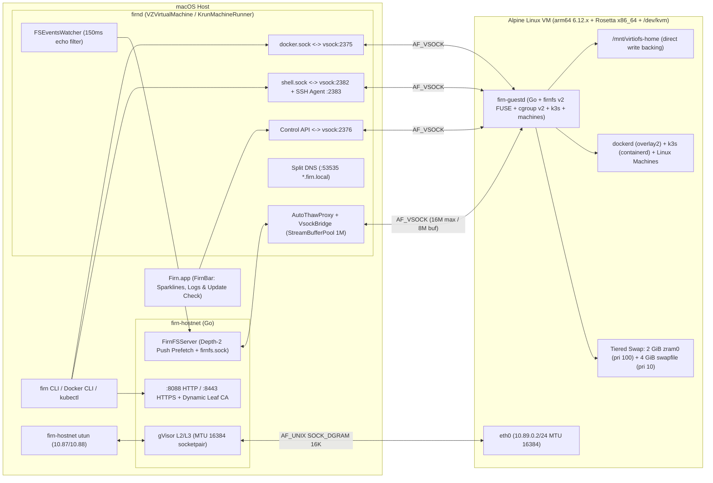

# Firn

[繁體中文](./README.zh-TW.md)

**Firn** is an open-source, lightweight macOS Docker, Kubernetes, and Linux VM runtime built natively in Swift and Go on Apple's `Virtualization.framework` (`VZVirtualMachine`), `virtio-vsock`, jumbo `virtio-net` (`MTU 16384`), hybrid `firnfs` v2, and Rosetta (`x86_64`).

It installs cleanly with a single command (zero `zstd` or host `e2fsprogs` dependency, auto-pulling guest images and creating a `120 GiB` APFS sparse disk on first `firn up`) and delivers **~1.5–2.0s guest boot / ~2.0–2.5s cold `firn up`**, **~0.4–5.6% idle host CPU**, **`6,950 req/s` HTTP/1.1 keep-alive**, **`2.51 ms` local `:8443` HTTPS (`3,679 req/s` conn/req)**, **`0.132 ms` PostgreSQL `SELECT 1` RTT**, **`365–423 ms` cold 1,000-file walks / `98 ms` in-container reads via Depth-2 prefetch `firnfs` + 150ms `FSEvents` self-echo suppression**, **APFS VM state hibernation (`759.6 MiB -> 20.3 MiB`, `0 MiB` VM XPC footprint, `1.47s` resume)**, **built-in `k3s` Kubernetes (`firn k8s`)**, **multi-distro Linux machines (`firn machine`)**, **optional `utun` direct container IP routing**, **opt-in `--nested-kvm` (`/dev/kvm`)**, **Metal/Vulkan GPU acceleration via `krunkit`**, and a **native Menu Bar app (`Firn.app`) with CoreGraphics sparklines, streaming logs & update notifications**.

## Why Firn?

- **Zero VM footprint on hibernate & session-safe auto-hibernate**: Event-driven Docker `/events` long-polling keeps an awake VM at low CPU (`0.4%` quiescent). Calling `firn hibernate` (or setting `firn up --hibernate-seconds N` / `FIRN_HIBERNATE_SECONDS`) waits for zero active vsock/auto-thaw connections, saves VM state to APFS (`saveMachineStateTo`), and tears down the `VZVirtualMachine` XPC process—dropping host footprint from **`759.6 MiB` to `20.3 MiB` (`0 MiB` VM footprint)** while transparently resuming (`1.47s` on warm APFS cache) on the next `docker` or `*.firn.local` request.
- **`firnfs` v2 Depth-2 streaming prefetch + live macOS coherency**: Combines asynchronous Depth-2 subdirectory streaming (`fsOpPushPrefetch = 0x81`, skipping `.git` / `node_modules` / `.cache`), `FOPEN_CACHE_DIR`, `FOPEN_NOFLUSH`, negative entry lookups, a **64 MiB LRU cache**, and macOS **`FSEvents`** push invalidation with `150ms` local write self-echo suppression—cutting cold 1,000-file walks by **`2.0–2.3×` (`365–423 ms`)**, keeping 1,000-file reads under `100 ms` (`78–98.5 ms`), and lifting `500 × 4 KiB` create+write+remove throughput through `/mnt/virtiofs-home` (`266.7 ms` in-container / `570.1 ms` wall).
- **Pooled `1 MiB` full-duplex `AF_VSOCK` splicing**: Reusable page-aligned `1 MiB` buffer pools in `StreamBufferPool` with `16 MiB` max / `8 MiB` target guest `SO_VM_SOCKETS_BUFFER` windows deliver up to **`6,950.3 req/s`** HTTP/1.1 Keep-Alive (`p50 2.03 ms`), **`4,454.2 req/s`** conn/req, **`0.132 ms`** PG `SELECT 1` RTT, **`398 MiB/s`** PG bulk queries, and **`921–969 MiB/s`** raw TCP.
- **Standalone Go `firn-hostnet` engine (zero `vmenet*` consumption)**: Uses a connected `AF_UNIX SOCK_DGRAM` `socketpair` with `MTU 16384` (`VZFileHandleNetworkDeviceAttachment`) + gVisor L2/L3 netstack and dynamic in-memory TLS leaf cert minting—serving local `https://*.firn.local:8443` in **`2.51 ms` (`3,678.9 req/s`)** and sustained outbound container HTTPS even on hosts with `251` `vmenet*` interfaces.
- **Zero-dependency install & hardened self-update**: Install via a single `curl | bash` script or Homebrew, let `firn up` automatically fetch signed/checksummed guest images and allocate sparse `data.ext4` without external tools, inspect with `firn images status`, and self-update safely via `firn upgrade` (SHA-256 verification of macOS + Linux archives before touching the daemon, `codesign` virtualization entitlement verification, atomic `.bak` rollback, and `FirnBar` menu notifications).
- **Built-in Kubernetes, Linux Machines, Nested KVM, `utun` & Metal GPU**: One-command `firn k8s enable` (`k3s v1.31.6+k3s1`, safe kubeconfig merge preserving existing `current-context`), persistent `firn machine` environments (`ubuntu`, `debian`, `alpine`, `arch`, `fedora`), opt-in `--nested-kvm` (`/dev/kvm`), non-conflicting `firn route` direct `10.87.0.0/24` + `10.88.0.0/16` routing, and optional `libkrun`/`krunkit` VirtIO-GPU Venus acceleration.

## Install & Quick Start

### Option A: One-Line Installer (Prebuilt Release, macOS Apple Silicon)

```sh
curl -fsSL https://raw.githubusercontent.com/zxzinn/firn/main/scripts/install.sh | bash
firn up
```

The installer extracts native gzipped tarballs cleanly using system `/usr/bin/tar` (preserving sparse `rootfs.ext4`), verifies `SHA256SUMS.txt`, preserves the `com.apple.security.virtualization` entitlement on `firnd`, and places `firn`, `firnd`, `firn-hostnet`, and `Firn.app` in `~/.local/bin` (override with `FIRN_INSTALL_DIR`). On first `firn up`, Firn also automatically pulls any missing guest images from the matching GitHub Release (opt out with `--no-pull`) and creates a `120 GiB` APFS sparse `~/.firn/data.ext4` (`0 B` initial allocation).

### Option B: Homebrew

```sh
brew install --formula packaging/homebrew/firn.rb
firn up
```

### Option C: Build From Source

Prerequisites: macOS 14+ (`macOS 15+` for `--nested-kvm`), Xcode Command Line Tools (`swift`), Go matching `guest/firn-guestd/go.mod`, Docker CLI + Compose v2 (`docker`), a builder context (`BUILD_DOCKER_CONTEXT`) for `make rootfs`, and optional `kubectl` / `krunkit`.

```sh
# Build Alpine kernel/rootfs, firn-guestd, firn-hostnet, firn CLI, firnd daemon, and Firn.app
make build

# Start Firn VM (registers 'firn' Docker context without overwriting your default context)
build/firn up

# Run containers, Linux machines, or single-node Kubernetes against Firn
docker --context firn ps
build/firn machine create dev --distro ubuntu && build/firn machine shell dev
build/firn k8s enable && kubectl --context firn get nodes

# Switch default Docker context safely (restorable via `firn context restore`)
build/firn context use
```

## Benchmarks (v0.5.0, Apple Silicon macOS)

Reproducible suite (`scripts/benchmark.py`) run on **Apple M5 Max** (18-core CPU, 36.0 GiB RAM, macOS 27.2.1, Docker `29.8.2`, Compose `5.5.0`, `251` host `vmenet*` interfaces present):

```sh
python3 scripts/benchmark.py --contexts firn        # Benchmark Firn runtime
python3 scripts/benchmark.py --compare              # Side-by-side firn vs orbstack table
python3 scripts/benchmark.py --json                 # Full structured JSON report
```

> **Measurement context**: `Firn v0.5.0` was evaluated live under heavy concurrent workstation CPU contention (`load average: 19.0–32.6` with external `node`/`Keynote`/Spotlight and OrbStack hosting 9 background stacks / 62 containers at `89.6–293.2%` CPU). `Firn v0.5.0` Cat 3–4 figures show the dedicated tuned run (`load 30.2–32.6`) alongside Cat 1–2 & 5–7 from the full suite run (`load 21.9–27.4`), compared directly against a same-moment OrbStack Cat 3–4 run on that exact loaded host plus prior quiescent `v0.4.0` / `OrbStack` baselines.

### Categories 1–6: Cross-Runtime Comparison

| Category | Metric | Firn v0.5.0 (live M5 Max) | Firn v0.4.0 (quiescent) | OrbStack (same-moment / ref) |
| --- | --- | --- | --- | --- |
| **1. Lifecycle & CLI** | `docker version` (5x median) | `44.87 ms` | **`21.26 ms`** | `22.5 ms` |
| | `docker run --rm alpine:3.21 true` (5x median) | `454.42 ms` | **`379.75 ms`** | `477.6 ms` |
| | `docker run --rm --entrypoint true postgres:18-alpine` (5x median) | `700.35 ms` | `460.64 ms` | **`408.4 ms`** |
| | 3-service Compose warm `up -d --wait` (`postgres` + `valkey` + `mailpit`) | `2,289.48 ms` | `2,391.66 ms` | **`2,072.9 ms`** |
| | 3-service Compose `down -v --remove-orphans` | `1,823.49 ms` | `1,582.06 ms` | **`825.5 ms`** |
| **2. Volume Disk I/O** | Sequential Write 256 MiB (`dd ... bs=1M count=256 conv=fsync`) | `1,100.9 MiB/s` (`232.54 ms`) | **`1,814.6 MiB/s`** (`141.1 ms`) | `1,724.3 MiB/s` (`148.5 ms`) |
| | Sequential Read 256 MiB (`dd`, page-cached post-write) | **`5,169.9 MiB/s`** (`49.52 ms`) | `3,728.4 MiB/s` (`68.7 ms`) | `4,913.7 MiB/s` (`52.1 ms`) |
| | Small-file burst (`1,000 × 4 KiB` create + write + `fsync` + unlink) | `1,393.5 ms` (`717.6 ops/s`) | **`836.4 ms` (`1,195.6 ops/s`)** | `1,654.9 ms` (`604.3 ops/s`) |
| **3. Host Shared FS** | 1,000-file tree walk (`find /work -type f`, cold / 3x median) | **`365.21 ms` cold / `368.89 ms` med** | `849.5 ms` cold / `441.1 ms` med | `3,020.8 ms` cold / `1,181.6 ms` med (same-moment) |
| | Read all 1,000 files (in-container / wall) | `98.51 ms` (`498.26 ms` wall) | `78.0 ms` (`409.7 ms` wall) | **`61.13 ms`** (`983.8 ms` wall, same-moment) |
| | Create + write + remove `500 × 4 KiB` files (in-container / wall) | **`266.72 ms`** (**`570.06 ms`** wall) | `383.6 ms` (`759.6 ms` wall) | `283.22 ms` (`1,067.0 ms` wall, same-moment) |
| **4. Host ↔ Container Net** | Raw TCP 128 MiB Host → Container | `908.9 MiB/s` (`140.83 ms`) | `921.4 MiB/s` (`138.9 ms`) | **`2,360.3 MiB/s`** (`54.2 ms` ref) |
| | Raw TCP 128 MiB Container → Host | `726.8 MiB/s` (`176.12 ms`) | `969.0 MiB/s` (`132.1 ms`) | **`4,172.3 MiB/s`** (`30.7 ms` ref) |
| | HTTP/1.1 Keep-Alive (500 req, c=16, Mailpit `/api/v1/info`) | **`6,950.3 req/s`** (`p50 2.032 ms`) | `5,197.8 req/s` (`p50 2.63 ms`) | `2,180.7 req/s` (same-moment) |
| | HTTP/1.1 Conn-per-req (500 req, c=16, Mailpit `/api/v1/info`) | **`4,454.2 req/s`** (`p50 3.376 ms`) | `4,061.7 req/s` (`p50 3.65 ms`) | `1,458.4 req/s` (same-moment) |
| | Local HTTPS `https://mailpit.<stack>.firn.local:8443/api/v1/info` | **`HTTP 200` (`2.51 ms`**, **`3,678.9 req/s`** `c=16`) | `HTTP 200` (`3.05 ms`, `2,981.8 req/s`) | — |
| | PostgreSQL `200x SELECT 1` RTT (avg / p50 / p95) | **`0.132 / 0.129 / 0.159 ms`** | `0.136 / 0.132 / 0.166 ms` | `1.141 / 0.903 / 2.698 ms` (same-moment) |
| | PostgreSQL `19.25 MiB` bulk query (`20,185 × 1,000 B`, 3x median) | `397.6 MiB/s` (`48.41 ms`) | **`398.3 MiB/s`** (`48.34 ms`) | `206.3 MiB/s` (same-moment) |
| **5. Outbound Egress** | Unproxied HTTPS inside `alpine:3.21` (`251` host `vmenet*` present) | `HTTP 200` (`1.41 MiB/s`, `0.329s`) | **`HTTP 200`** (`1.81 MiB/s`, `0.258s`) | **`HTTP 200`** (`1.83 MiB/s`, `0.25s` ref) |
| **6. Image Build** | `docker build --no-cache` (`FROM alpine:3.21`, 500 files) | `756.96 ms` | **`338.07 ms`** | `2,180.0 ms` (`ref`) |

### Category 7 & Runtime Lifecycle (v0.5.0 Verified)

| Metric | Observed Result (v0.5.0) |
| --- | --- |
| Clean VM shutdown (`firn down`) | `1,710.67 ms` (`835.82 ms` quiescent in v0.4.0) |
| Cold VM boot (`firn up` auto-hibernate check / Cat 7 suite) | `1,689.4 ms` (`2.25s` auto-hibernate run) / `2,653.32 ms` wall (`2.03s` guest uptime under load `21.9–27.4`) |
| Idle host usage (`top`, 0 containers, loaded host) | `5.6%` CPU / **`769.2 MiB`** (`firnd 32.6 + vm 736.6`, vs OrbStack Helper `89.6%` CPU / `2,675.3 MiB` RSS) |
| Hibernate (`firn hibernate`, APFS `saveMachineStateTo`) | **`759.6 MiB → 20.3 MiB`** (`169.0 MiB` state, `0 MiB` VM XPC); **`firn resume` in `1,467.3 ms`** |
| Post-resume `firnfs` Cat 3 coherence & speed | `423.28 ms` cold / `399.41 ms` med walk, **`98.37 ms`** read, `403.62 ms` create+write+rm |
| Session-guarded Auto-Hibernate (`--hibernate-seconds 15`) | Zero active-session interruptions and zero snapshot save races across transitions |
| 3 simultaneous stacks (`valkey` + `mailpit`, 6 containers) reclaim | `99.62 MiB → 18.77 MiB` (**`81.2%` reclaimed**, `4.8 MiB` in `zram0`) |
| Target-first Auto-Thaw (Valkey `PING` / HTTPS `:8443` from frozen) | **`29.68 ms` TCP** / **`27.71 ms` HTTPS** (`pausedCount = 0`; `guestThaw = 13.94 ms`, `hostThaw = 14.46 ms`) |
| Built-in Kubernetes (`firn k8s enable`) | `k3s v1.31.6+k3s1` `Ready` on `127.0.0.1:6443` (preserves existing `kubectl` `current-context`) |
| Multi-distro Linux Machines (`firn machine create testbox --distro alpine`) | Assigned `10.87.0.2` + `testbox.firn.local`, interactive PTY `shell`, shared `$HOME` |
| Opt-in Nested KVM (`firn up --nested-kvm`) | Exposes `/dev/kvm` (`crw-rw-rw- 1 root kvm`) inside guest |

## Architecture



## CLI Reference

| Command | Description |
| --- | --- |
| `firn up [--cpus N] [--memory-gib N] [--context NAME] [--backend vz\|krun] [--fs firnfs\|virtiofs] [--disk-sync none\|fsync] [--hibernate-seconds N] [--no-pull] [--gpu] [--nested-kvm]` | Auto-pull missing images & sparse `data.ext4`, boot/wake VM, sync config, and register Docker context |
| `firn down` | Request clean guest poweroff (`k3s`, `fstrim`, swapoff, ro remount) and stop `firnd` |
| `firn images <status\|pull [--version vX.Y.Z] [--force]>` | Inspect installed VM kernel/initramfs/rootfs/data.ext4 allocation or download a verified Release image set |
| `firn upgrade [--check] [--version vX.Y.Z]` | Semver-aware self-update with Homebrew detection, SHA-256 verification, `codesign` entitlement preservation, guest image sync & `.bak` rollback |
| `firn hibernate [--json]` | Save VM state to APFS (`vm-state.vzvmsave`) or park VM, dropping VM XPC memory to `0 MiB` |
| `firn resume [--json]` | Restore hibernated VM immediately (`firn` also wakes automatically on traffic) |
| `firn status [--json]` | Show guest/host memory, CPU%, capabilities, APFS disk, DNS/HTTPS, route, and stacks |
| `firn shell [-- COMMAND...]` | Open interactive PTY shell (`vsock:2382`) with `SSH_AUTH_SOCK` forwarding |
| `firn k8s <status\|enable [--no-kubeconfig] [--use]\|disable\|reset\|freeze\|thaw\|kubeconfig>` | Manage built-in `k3s` Kubernetes cluster with non-destructive kubeconfig merge |
| `firn machine <list\|create <name> [--distro D]\|shell <name>\|start\|stop\|delete>` | Manage persistent Ubuntu/Debian/Alpine/Arch/Fedora machines sharing `$HOME` |
| `firn route <status\|up\|install [--dns]\|uninstall\|dns <status\|on\|off>>` | Manage host `utun` direct routing to container subnets (`10.87.0.0/24`, `10.88.0.0/16`) |
| `firn freeze <project> [--reclaim]` | Freeze Compose stack (`cgroup.freeze`) and reclaim RAM + drop caches |
| `firn thaw <project>` | Unpause a frozen Compose stack (auto-thaws on traffic) |
| `firn reclaim [project]` | Reclaim cold container pages without manual pause |
| `firn balloon <shrink\|reset>` | Shrink memory balloon to guest demand or reset to `maxMemoryBytes` |
| `firn disk <usage\|trim> [--json]` | Inspect APFS sparse disk + `zram0` usage or run online `fstrim` |
| `firn dns <status\|install\|uninstall>` | Inspect DNS records or install/remove `/etc/resolver/<domain>` (`sudo`) |
| `firn ca <status\|install\|uninstall>` | Inspect Firn Root CA or trust/untrust in macOS System Keychain (`sudo`) |
| `firn https <status\|install\|uninstall>` | Inspect `:8443` TLS proxy or manage `:80`/`:443` `pf` anchor (`sudo`) |
| `firn context <status\|use\|restore>` | Show, switch to, or restore your previous default Docker context |
| `firn proxy` | Show detected macOS HTTP/HTTPS proxy, VPN, DNS, and `SSH_AUTH_SOCK` relay state |
| `firn gui` | Launch `Firn.app` (`FirnBar`) menu bar monitor with sparklines, log viewer & update check |
| `firn doctor` | Diagnose Hypervisor, Nested KVM, Metal GPU/`krunkit`, `firn-hostnet`, images, entitlements, `k3s`, CA, DNS, `pf`, and disk |
| `firn autostart <status\|install\|uninstall>` | Manage optional user LaunchAgent (`~/Library/LaunchAgents/dev.firn.firnd.plist`) |
| `firn bench [--project NAME] [--compare-orbstack]` | Benchmark freeze/reclaim and thaw latency |
| `firn logs [--serial\|--daemon\|--hostnet]` | Tail VM serial console, `firnd`, or `firn-hostnet` logs |

## Local Domains & HTTPS (`*.firn.local`)

Every Compose container with exposed TCP ports (and every `firn machine`) gets automatic DNS records (`<container>.firn.local`, `<service>.<project>.firn.local`):

1. Optional macOS split DNS: `sudo firn dns install`
2. Optional trusted local HTTPS (`https://<service>.<project>.firn.local:8443`): `sudo firn ca install`
3. Optional zero-port `http://` and `https://` (`:80` / `:443` `pf` redirect): `sudo firn https install`

## Compose Labels & Configuration

```yaml
services:
  postgres:
    image: postgres:18-alpine
    labels:
      - "firn.reaper.exempt=true"   # Never auto-freeze this Compose project

  worker:
    labels:
      - "firn.reaper.idle=300"      # Override idle timeout (seconds; "0" disables freeze)
```

Global settings live in `~/.firn/config.json` (editable via `FirnBar` → **Settings…**) and can be overridden with environment variables:

- `FIRN_HOME` (default `~/.firn`), `FIRN_CONTEXT` (default `firn`)
- `FIRN_CPUS` (default `8`), `FIRN_MEMORY_GIB` (default `8`), `FIRN_MIN_BALLOON_MIB` (default `768`)
- `FIRN_DISK_SYNC` (`none` default or `fsync`), `FIRN_FS_MODE` (`firnfs` default or `virtiofs`)
- `FIRN_BACKEND` (`vz` default or `krun`), `FIRN_GPU` (`false` default), `FIRN_NESTED_VIRT` (`false` default)
- `FIRN_HIBERNATE_SECONDS` (`0` disables auto-hibernate), `FIRN_IDLE_SECONDS` (`900`), `FIRN_EXEMPT_PROJECTS`
- `FIRN_DOMAIN` (`firn.local`), `FIRN_DNS_PORT` (`53535`), `FIRN_HTTP_PROXY_PORT` (`8088`), `FIRN_HTTPS_PROXY_PORT` (`8443`), `FIRN_DIRECT_ROUTE_DNS` (`false`)
- `FIRN_INSTALL_DIR` (used by `scripts/install.sh`), `FIRN_IMAGE_VERSION` / `BUILD_DOCKER_CONTEXT` (used by `make build` / `guest/build-rootfs.sh`)

## Packaging & Homebrew

A Homebrew formula is provided at [packaging/homebrew/firn.rb](./packaging/homebrew/firn.rb), a standalone installer at [scripts/install.sh](./scripts/install.sh), and multi-job CI/release workflows live under [.github/workflows/ci.yml](./.github/workflows/ci.yml) and [.github/workflows/release.yml](./.github/workflows/release.yml).

## Contributing & License

See [CONTRIBUTING.md](./CONTRIBUTING.md) and [SECURITY.md](./SECURITY.md). Licensed under the [Apache License 2.0](./LICENSE).
