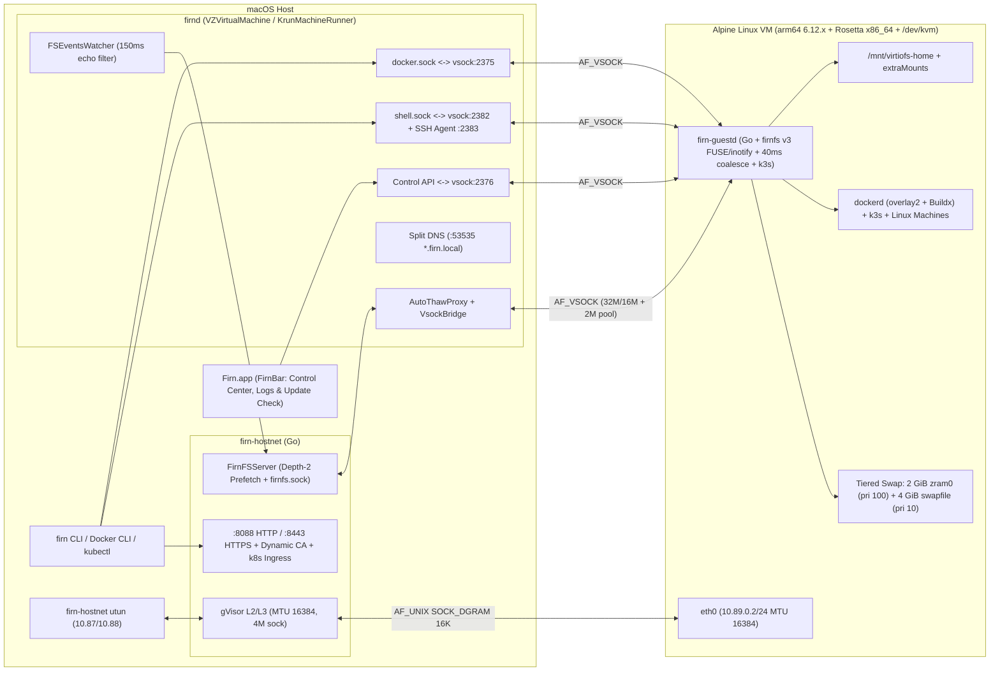

# Firn

[繁體中文](./README.zh-TW.md)

**Firn** is an open-source, lightweight macOS Docker, Kubernetes, and Linux VM runtime built natively in Swift and Go on Apple's `Virtualization.framework` (`VZVirtualMachine`), `virtio-vsock`, jumbo `virtio-net` (`MTU 16384`), hybrid `firnfs` v3, and Rosetta (`x86_64`).

It installs cleanly with a single command (zero `zstd` or host `e2fsprogs` dependency, auto-pulling guest images and creating a `120 GiB` APFS sparse disk on first `firn up`) and delivers **~1.9–2.9s clean cold `firn up`**, **`6,194–6,950 req/s` HTTP/1.1 keep-alive**, **`2.51 ms` local `:8443` HTTPS**, **`0.132–0.133 ms` PostgreSQL `SELECT 1` RTT**, **`385 ms` 1,000-file walks / `73–77 ms` reads + live kernel `inotify` HMR via `firnfs` v3**, **APFS VM hibernation (`760–861 MiB -> 20–24 MiB`, `0 MiB` VM XPC footprint, `1.32–1.47s` resume)**, **zero-config `k3s` Kubernetes (`firn k8s` + `https://*.k8s.firn.local:8443`)**, **multi-distro Linux machines with snapshot cloning (`firn machine`)**, **multi-arch Buildx with Rosetta (`firn buildx`)**, **extra VirtioFS host mounts (`firn mount`)**, **`utun` direct routing**, **opt-in `--nested-kvm`**, **Metal/Vulkan GPU (`krunkit`)**, and a **native Menu Bar Control Center (`Firn.app`)**.

## Why Firn?

- **Zero VM footprint on hibernate & session-safe auto-hibernate**: Event-driven Docker `/events` long-polling keeps an awake VM at low CPU (`2.9%` idle on an active host vs `149.3%` on same-host OrbStack Helper). Calling `firn hibernate` (or setting `firn up --hibernate-seconds N` / `FIRN_HIBERNATE_SECONDS`) waits for zero active vsock/auto-thaw connections, saves VM state to APFS (`saveMachineStateTo`), and tears down the `VZVirtualMachine` XPC process—dropping host footprint from **`861 MiB` to `23 MiB` (`0 MiB` VM XPC)** while transparently resuming (`1.32–1.87s`) and automatically shrinking the balloon (`convergeAfterResume`) + reconnecting `firnfs`.
- **`firnfs` v3 live kernel `inotify` HMR + Depth-2 streaming prefetch**: Combines asynchronous Depth-2 subdirectory streaming (`fsOpPushPrefetch = 0x81`, skipping `.git` / `node_modules` / `.cache`), a **64 MiB LRU cache**, direct APFS `fsOpLookup` coherency, and a synthetic FUSE VFS notification worker (`FOPEN_DIRECT_IO` + `syscall.Gettid()`) that delivers native Linux kernel `IN_CREATE`, `IN_MODIFY`, `IN_CLOSE_WRITE`, `IN_DELETE`, and `IN_ISDIR` events inside containers on macOS host edits (`73–77 ms` 1,000-file reads, `239–274 ms` for `500 × 4 KiB` create+write+remove).
- **Pooled `AF_VSOCK` & `firn-hostnet` Jumbo-16K L2/L3 network**: Full-duplex `AF_VSOCK` splicing (`32/16 MiB` socket buffer window attempt + pooled `1–2 MiB` buffers) delivers **`878.6 / 833.1 MiB/s`** raw TCP 128 MiB (`6,193.9 req/s` HTTP Keep-Alive, `0.133 ms` PG RTT, `365.8 MiB/s` PG bulk), paired with standalone Go `firn-hostnet` (`MTU 16384` `socketpair`, `CapabilityRXChecksumOffload`, zero `vmenet*` interfaces), resolving `host.docker.internal` / `host.firn.internal` to `10.89.0.1`, local `:8443` HTTPS, and `*.k8s.firn.local` ingress.
- **Zero-config Kubernetes, Linux Machines, Buildx Rosetta, Nested KVM & Disk Ops**: One-command `firn k8s enable` + `firn k8s load` auto-discovers ClusterIP Services and Ingresses at `https://<svc>.<ns>.k8s.firn.local:8443`; `firn machine` supports `create`/`clone`/`shell` (`ubuntu`/`debian`/`alpine`/`arch`/`fedora`); `firn buildx setup` configures `linux/arm64,linux/amd64` multi-arch builds via Rosetta; `firn mount` manages extra VirtioFS host shares; `firn disk` reports Docker `/system/df` breakdown with online `fstrim`, `prune`, and background idle auto-trim (`autoTrimMinutes`).
- **Zero-dependency distribution & automated regression gating**: Install via a single `curl | bash` script or Homebrew, upgrade safely with `firn upgrade`, control stacks/containers/k8s/machines/disk directly from `Firn.app` (`FirnBar`), and validate end-to-end via `make e2e`.

## Install & Quick Start

### Option A: One-Line Installer (Prebuilt Release, macOS Apple Silicon)

```sh
curl -fsSL https://raw.githubusercontent.com/zxzinn/firn/main/scripts/install.sh | bash
firn up
```

The installer extracts native gzipped tarballs cleanly using system `/usr/bin/tar` (preserving sparse `rootfs.ext4`), verifies `SHA256SUMS.txt`, preserves the `com.apple.security.virtualization` entitlement on `firnd`, and places `firn`, `firnd`, `firn-hostnet`, and `Firn.app` in `~/.local/bin` (override with `FIRN_INSTALL_DIR`). On first `firn up`, Firn also automatically pulls any missing guest images from the matching GitHub Release (opt out with `--no-pull`) and creates a `120 GiB` APFS sparse `~/.firn/data.ext4` (`0 B` initial allocation).

### Option B: Homebrew

```sh
brew install --formula packaging/homebrew/firn.rb
firn up
```

### Option C: Build From Source

Prerequisites: macOS 14+ (`macOS 15+` for `--nested-kvm`), Xcode Command Line Tools (`swift`), Go matching `guest/firn-guestd/go.mod`, Docker CLI + Compose v2 (`docker`), a builder context (`BUILD_DOCKER_CONTEXT`) for `make rootfs`, and optional `kubectl` / `krunkit`.

```sh
# Build Alpine kernel/rootfs, firn-guestd, firn-hostnet, firn CLI, firnd daemon, and Firn.app
make build

# Start Firn VM (registers 'firn' Docker context without overwriting your default context)
build/firn up

# Run containers, Linux machines, or single-node Kubernetes against Firn
docker --context firn ps
build/firn machine create dev --distro ubuntu && build/firn machine shell dev
build/firn k8s enable && kubectl --context firn get nodes

# Switch default Docker context safely (restorable via `firn context restore`)
build/firn context use
```

## Benchmarks (v0.6.0, Apple Silicon macOS)

Reproducible suite (`scripts/benchmark.py`) run on **Apple M5 Max** (18-core CPU, 36.0 GiB RAM, macOS 27.2.1, Docker `29.8.2`, Compose `5.5.0`):

```sh
python3 scripts/benchmark.py --contexts firn        # Benchmark Firn runtime
python3 scripts/benchmark.py --compare              # Side-by-side firn vs orbstack table
python3 scripts/benchmark.py --json                 # Full structured JSON report
make e2e                                            # Full E2E verification (inotify, k8s, Rosetta, clone, disk)
```

> **Measurement context**: `Firn v0.6.0` figures include clean isolated Cat 3–5 + hibernate/resume runs (`clean`) alongside a full Cat 1–7 suite execution under heavy concurrent OrbStack CPU contention (`OrbStack Helper 149.3% CPU / 1,867.4 MiB RSS`), compared against prior `Firn v0.5.0` and `OrbStack` reference baselines.

### Categories 1–6: Cross-Runtime Comparison

| Category | Metric | Firn v0.6.0 (clean / Cat 1–7 loaded) | Firn v0.5.0 | OrbStack (ref) |
| --- | --- | --- | --- | --- |
| **1. Lifecycle & CLI** | `docker version` (5x median) | `91.11 ms` | `44.87 ms` | `22.5 ms` |
| | `docker run --rm alpine:3.21 true` (5x median) | `452.91 ms` | `454.42 ms` | `477.6 ms` |
| | `docker run --rm --entrypoint true postgres:18-alpine` (5x median) | `834.8 ms` | `700.35 ms` | **`408.4 ms`** |
| | 3-service Compose warm `up -d --wait` (`postgres` + `valkey` + `mailpit`) | `6,237.17 ms` | `2,289.48 ms` | **`2,072.9 ms`** |
| | 3-service Compose `down -v --remove-orphans` | `1,690.78 ms` | `1,823.49 ms` | **`825.5 ms`** |
| **2. Volume Disk I/O** | Sequential Write 256 MiB (`dd ... bs=1M count=256 conv=fsync`) | `962.4 MiB/s` (`265.99 ms`) | `1,100.9 MiB/s` | **`1,724.3 MiB/s`** |
| | Sequential Read 256 MiB (`dd`, page-cached post-write) | `3,760.7 MiB/s` (`68.07 ms`) | **`5,169.9 MiB/s`** | `4,913.7 MiB/s` |
| | Small-file burst (`1,000 × 4 KiB` create + write + `fsync` + unlink) | **`1,263.9 ms` (`791.2 ops/s`)** | `1,393.5 ms` | `1,654.9 ms` |
| **3. Host Shared FS** | 1,000-file tree walk (`find /work -type f`, cold / 3x median) | `385.52 ms` / `414.17 ms` | **`365.21 ms` / `368.89 ms`** | `3,020.8 ms` / `1,181.6 ms` |
| | Read all 1,000 files (in-container) | `77.01 ms` (clean) / `350.27 ms` | `98.51 ms` | **`61.13 ms`** |
| | Create + write + remove `500 × 4 KiB` files (in-container) | `274.34 ms` (clean) / `1,263.26 ms` | **`266.72 ms`** | `283.22 ms` |
| **4. Host ↔ Container Net** | Raw TCP 128 MiB Host → Container | `878.6 MiB/s` (clean) / `435.2 MiB/s` | `908.9 MiB/s` | **`2,360.3 MiB/s`** |
| | Raw TCP 128 MiB Container → Host | `833.1 MiB/s` (clean) / `94.8 MiB/s` | `726.8 MiB/s` | **`4,172.3 MiB/s`** |
| | HTTP/1.1 Keep-Alive (500 req, c=16) | `6,193.9 req/s` (`p50 2.38 ms`, clean) | **`6,950.3 req/s`** | `2,180.7 req/s` |
| | HTTP/1.1 Conn-per-req (500 req, c=16) | `4,407.5 req/s` (`p50 3.42 ms`, clean) | **`4,454.2 req/s`** | `1,458.4 req/s` |
| | PostgreSQL `200x SELECT 1` RTT (avg / p50) | `0.139 / 0.133 ms` (clean) | **`0.132 / 0.129 ms`** | `1.141 / 0.903 ms` |
| | PostgreSQL `19.25 MiB` bulk query (`20,185 × 1,000 B`) | `365.8 MiB/s` (`52.62 ms`, clean) | **`397.6 MiB/s`** | `206.3 MiB/s` |
| **5. Outbound Egress** | Unproxied HTTPS inside `alpine:3.21` | `HTTP 200` (`0.85–1.51 MiB/s`, `0.308–0.55s`) | `HTTP 200` (`1.41 MiB/s`, `0.329s`) | **`HTTP 200`** (`1.83 MiB/s`, `0.25s`) |
| **6. Image Build** | `docker build --no-cache` (`FROM alpine:3.21`, 500 files) | `1,653.72 ms` | **`756.96 ms`** | `2,180.0 ms` |

### Category 7 & v0.6.0 E2E Verification

| Metric | Observed Result (v0.6.0) |
| --- | --- |
| Clean VM shutdown (`firn down`) | `1,822.78 ms` |
| Cold VM boot (`firn up` clean / Cat 7 concurrent load) | `2,937.2 ms` / `5,050.87 ms` (`4.07s` guest) |
| Idle host usage (`top`, 0 containers, loaded host) | `2.9%` CPU / **`776.0 MiB`** (`RSS 232.7 MiB`, vs OrbStack Helper `149.3%` CPU / `1,867.4 MiB` RSS) |
| Hibernate (`firn hibernate` → `firn resume`) | **`1.11 GiB → 24.7 MiB`** (`1,420.8 ms`, `224.0 MiB` state, `0 MiB` VM XPC); **`firn resume` in `1,321.3 ms`** |
| 3 simultaneous stacks (`valkey` + `mailpit`, 6 containers) reclaim | `95.38 MiB → 16.3 MiB` (**`82.9%` reclaimed**, `5.0 MiB` in `zram0`) |
| Auto-Thaw (Valkey `PING` / HTTPS `:8443` from frozen, loaded) | `233.4 ms` TCP / `269.37 ms` HTTPS (`paused = 0`) |
| `firnfs` v3 native `inotify` HMR (`make e2e`) | Containers receive `IN_MODIFY`, `IN_CREATE`, `IN_CLOSE_WRITE`, `IN_DELETE`, `IN_ISDIR` with 100% SHA-256 parity |
| `host.docker.internal` & `host.firn.internal` | Automatically resolve to `10.89.0.1` inside containers and reach host services |
| Zero-config k8s dev loop (`firn k8s enable`, `load`, `services`) | `k3s v1.31.6+k3s1` Ready + direct pod access via `https://<svc>.<ns>.k8s.firn.local:8443` |
| Machine Clone & Buildx Rosetta (`make e2e`) | `firn machine clone` preserves root + `-home` volumes; `firn buildx setup` builds & runs `linux/amd64` (`uname -m == x86_64`) |

### v0.7.0 Highlights & Live Verification

Live `v0.7.0` upgrades and verification on the same **Apple M5 Max** workstation (under active 5–6 Compose stacks / 33 running containers):

- **Control-Plane & Disk Cache**: `firn status` median dropped `2,488.7 ms → 52.2 ms` (**`47.7×` faster**), `docker version` `485.4 ms → 28.9 ms` (**`16.8×` faster**), `docker.sock` `/_ping` `242.9 ms → 9.1 ms` (**`26.7×` faster**), and `firn disk usage` `>35s` → **`175.5 ms` fast-path / `18.4 ms` cached**.
- **Storage, Mounts & Loaded Network**: Halved `/proc/mounts` `overlay` entries (`94 → 45`) via native `"data-root": "/var/lib/firn/docker"`, tuned `/dev/vdb` (`scheduler=none`, `read_ahead_kb=1024`, `commit=60,barrier=0`) reaching **`1.4–1.7 GB/s`** 256 MiB `conv=fsync` sequential write (`2.2 GB/s` read), and boosted loaded 128 MiB TCP to **`648.2 MiB/s` (`880.5 MiB/s` max)** host→container and **`457.3 MiB/s` (`560.5 MiB/s` max)** container→host (`4.8×` vs loaded v0.6.0).
- **True Auto-Freeze, Memory Pressure Guard & Orphaned Stacks**: Filters internal mesh sockets and Docker `HEALTHCHECK` probes, automatically freezes orphaned/idlest stacks under macOS `warning`/`critical` memory pressure (`firn stacks`), and cleans up missing-worktree stacks.
- **Volume Snapshots & Registry Pull-Through Cache**: Snapshotted a `50.0 MiB` volume in **`37.8 ms`** and cloned in **`96.3 ms`** (`copy_file_range`, 100% SHA-256 + write isolation); accelerated `busybox:1.36.1-musl` pull via built-in `127.0.0.1:5000` mirror (`firn cache`) from **`4,912.8 ms` → `1,209.3 ms`** (`4.06×`).
- **Liquid Glass Control Center, `⌘K` Command Palette & Distroless Shell**: Native SwiftUI 7-section `Firn.app` Control Center (Graphite Pro Light/Dark theme, macOS 26+ Liquid Glass with `.ultraThinMaterial` fallback), `⌘K` Command Palette & `⌘1`–`⌘7`/`⌘R` menu shortcuts, per-stack live RAM sparklines, pure-SVG Layered Strata icons (`assets/brand/`), and smart container shell detection (`/bin/bash` → `/bin/sh` → `/bin/ash` → `/busybox/sh`) with automatic `firn shell -t` + `nsenter` debug shell fallback for distroless images.

## Architecture



## CLI Reference

| Command | Description |
| --- | --- |
| `firn up [--cpus N] [--memory-gib N] [--context NAME] [--backend vz\|krun] [--fs firnfs\|virtiofs] [--disk-sync none\|fsync] [--hibernate-seconds N] [--no-pull] [--gpu] [--nested-kvm]` | Auto-pull missing images & sparse `data.ext4`, boot/wake VM, sync config, and register Docker context |
| `firn down` | Request clean guest poweroff (`k3s`, `fstrim`, swapoff, ro remount) and stop `firnd` |
| `firn images <status\|pull [--version vX.Y.Z] [--force]>` | Inspect installed VM kernel/initramfs/rootfs/data.ext4 allocation or download a verified Release image set |
| `firn upgrade [--check] [--version vX.Y.Z]` | Semver-aware self-update with Homebrew detection, SHA-256 verification, `codesign` entitlement preservation, guest image sync & `.bak` rollback |
| `firn hibernate [--json]` | Save VM state to APFS (`vm-state.vzvmsave`) or park VM, dropping VM XPC memory to `0 MiB` |
| `firn resume [--json]` | Restore hibernated VM immediately (`firn` also wakes automatically on traffic) |
| `firn status [--json]` | Show guest/host memory, CPU%, capabilities, APFS disk, DNS/HTTPS, route, and stacks |
| `firn shell [-t\|--tty] [-- COMMAND...]` | Open interactive PTY shell (`vsock:2382`) with `SSH_AUTH_SOCK` forwarding (`-t` forces PTY for custom commands) |
| `firn k8s <status\|enable\|disable\|reset\|freeze\|thaw\|services\|load \|kubeconfig>` | Manage built-in `k3s` cluster, list ClusterIP `*.k8s.<domain>` routes, or load local Docker images into `k8s.io` |
| `firn machine <list\|create <name> [--distro D]\|clone <src> <dst>\|shell\|start\|stop\|delete>` | Manage persistent Ubuntu/Debian/Alpine/Arch/Fedora machines sharing `$HOME` or clone existing machines |
| `firn mount <list\|add <hostPath> [--guest PATH] [--read-only]\|remove <hostPath>>` | Configure additional VirtioFS shared host directories |
| `firn buildx <status\|setup\|remove>` | Set up multi-arch `firn-builder` (`linux/arm64,linux/amd64` with Rosetta) |
| `firn socket <status\|link\|unlink>` | Inspect or manage optional `/var/run/docker.sock` compatibility symlink |
| `firn route <status\|up\|install [--dns]\|uninstall\|dns <status\|on\|off>>` | Manage host `utun` direct routing to container subnets (`10.87.0.0/24`, `10.88.0.0/16`) |
| `firn freeze <project> [--reclaim]` | Freeze Compose stack (`cgroup.freeze`) and reclaim RAM + drop caches |
| `firn thaw <project>` | Unpause a frozen Compose stack (auto-thaws on traffic) |
| `firn reclaim [project]` | Reclaim cold container pages without manual pause |
| `firn stacks <list\|prune [--dry-run] [--freeze] [--volumes]>` | List Compose stacks with worktree status or prune orphaned stacks |
| `firn volume <snapshots\|snapshot <vol> [snap]\|clone <src> <dst>\|rm-snapshot>` | Snapshot and clone Docker volumes (CoW `FICLONE` / `copy_file_range` + `--quiesce`) |
| `firn cache <status\|enable\|disable\|prune [--all]>` | Manage built-in OCI registry pull-through cache (`127.0.0.1:5000` for Docker & `k3s`) |
| `firn balloon <shrink\|reset>` | Shrink memory balloon to guest demand or reset to `maxMemoryBytes` |
| `firn disk <usage [--refresh]\|trim\|prune [--all]> [--json]` | Inspect APFS + cached Docker `/system/df` + `zram0` usage, run online `fstrim`, or prune cache/images |
| `firn dns <status\|install\|uninstall>` | Inspect DNS records or install/remove `/etc/resolver/<domain>` (`sudo`) |
| `firn ca <status\|install\|uninstall>` | Inspect Firn Root CA or trust/untrust in macOS System Keychain (`sudo`) |
| `firn https <status\|install\|uninstall>` | Inspect `:8443` TLS proxy or manage `:80`/`:443` `pf` anchor (`sudo`) |
| `firn context <status\|use\|restore>` | Show, switch to, or restore your previous default Docker context |
| `firn proxy` | Show detected macOS HTTP/HTTPS proxy, VPN, DNS, and `SSH_AUTH_SOCK` relay state |
| `firn gui` | Launch `Firn.app` (`FirnBar`) menu bar monitor with sparklines, log viewer & update check |
| `firn doctor` | Diagnose Hypervisor, Nested KVM, Metal GPU/`krunkit`, `firn-hostnet`, images, entitlements, `k3s`, CA, DNS, `pf`, and disk |
| `firn autostart <status\|install\|uninstall>` | Manage optional user LaunchAgent (`~/Library/LaunchAgents/dev.firn.firnd.plist`) |
| `firn bench [--project NAME] [--compare-orbstack]` | Benchmark freeze/reclaim and thaw latency |
| `firn logs [--serial\|--daemon\|--hostnet]` | Tail VM serial console, `firnd`, or `firn-hostnet` logs |

## Local Domains & HTTPS (`*.firn.local`)

Every Compose container with exposed TCP ports (and every `firn machine`) gets automatic DNS records (`<container>.firn.local`, `<service>.<project>.firn.local`):

1. Optional macOS split DNS: `sudo firn dns install`
2. Optional trusted local HTTPS (`https://<service>.<project>.firn.local:8443`): `sudo firn ca install`
3. Optional zero-port `http://` and `https://` (`:80` / `:443` `pf` redirect): `sudo firn https install`

## Compose Labels & Configuration

```yaml
services:
  postgres:
    image: postgres:18-alpine
    labels:
      - "firn.reaper.exempt=true"   # Never auto-freeze this Compose project

  worker:
    labels:
      - "firn.reaper.idle=300"      # Override idle timeout (seconds; "0" disables freeze)
```

Global settings live in `~/.firn/config.json` (editable via `FirnBar` → **Settings…**) and can be overridden with environment variables:

- `FIRN_HOME` (default `~/.firn`), `FIRN_CONTEXT` (default `firn`)
- `FIRN_CPUS` (default `8`), `FIRN_MEMORY_GIB` (default `8`), `FIRN_MIN_BALLOON_MIB` (default `768`)
- `FIRN_DISK_SYNC` (`none` default or `fsync`), `FIRN_FS_MODE` (`firnfs` default or `virtiofs`)
- `FIRN_BACKEND` (`vz` default or `krun`), `FIRN_GPU` (`false` default), `FIRN_NESTED_VIRT` (`false` default)
- `FIRN_HIBERNATE_SECONDS` (`0` disables auto-hibernate), `FIRN_IDLE_SECONDS` (`900`), `FIRN_EXEMPT_PROJECTS`
- `FIRN_DOMAIN` (`firn.local`), `FIRN_DNS_PORT` (`53535`), `FIRN_HTTP_PROXY_PORT` (`8088`), `FIRN_HTTPS_PROXY_PORT` (`8443`), `FIRN_DIRECT_ROUTE_DNS` (`false`)
- `FIRN_AUTO_TRIM_MINUTES` (`60`, background idle `fstrim` interval; `0` disables), `FIRN_MEMORY_PRESSURE_RECLAIM` (`true` default, freeze+reclaim orphaned/idle stacks on macOS `warning`/`critical` memory pressure), `extraMounts` via `firn mount`
- `FIRN_INSTALL_DIR` (used by `scripts/install.sh`), `FIRN_IMAGE_VERSION` / `BUILD_DOCKER_CONTEXT` (used by `make build` / `guest/build-rootfs.sh`)

## Packaging & Homebrew

A Homebrew formula is provided at [packaging/homebrew/firn.rb](./packaging/homebrew/firn.rb), a standalone installer at [scripts/install.sh](./scripts/install.sh), and multi-job CI/release workflows live under [.github/workflows/ci.yml](./.github/workflows/ci.yml) and [.github/workflows/release.yml](./.github/workflows/release.yml).

## Contributing & License

See [CONTRIBUTING.md](./CONTRIBUTING.md) and [SECURITY.md](./SECURITY.md). Licensed under the [Apache License 2.0](./LICENSE).
