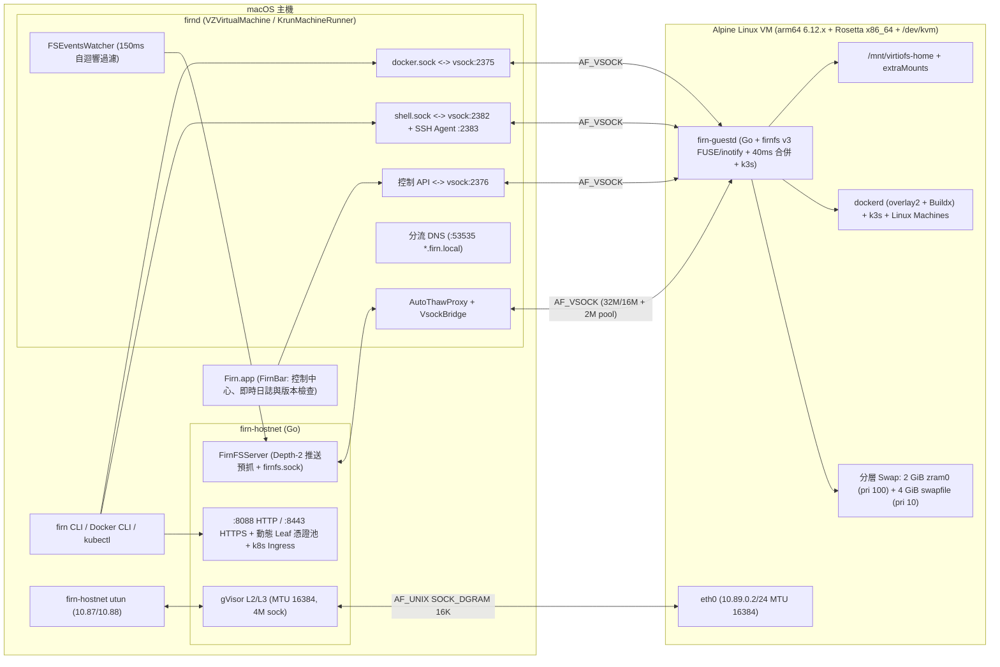

# Firn

[English](./README.md)

**Firn** 是一套開源、輕量級的 macOS Docker、Kubernetes 與 Linux VM 執行環境，以 Swift 與 Go 原生建構於 Apple `Virtualization.framework`（`VZVirtualMachine`）、`virtio-vsock`、Jumbo `virtio-net`（`MTU 16384`）、混合式 `firnfs` v3 與 Rosetta（`x86_64`）之上。

它提供免額外依賴的一鍵安裝與自動映像檔初始化（無需安裝 `zstd` 或 `e2fsprogs`，首次執行 `firn up` 即自動拉取 Guest 映像檔並建立 `120 GiB` APFS 稀疏磁碟），具備 **約 1.9–2.9 秒冷啟動**、**`6,194–6,950 req/s` HTTP/1.1 Keep-Alive**、**`2.51 ms` 本機 `:8443` HTTPS**、**`0.132–0.133 ms` PostgreSQL `SELECT 1` RTT**、**`firnfs` v3 原生 Linux `inotify` 熱重載（千檔讀取 `73–77 ms`）**、**APFS 休眠快照（宿主記憶體 `760–861 MiB → 20–24 MiB`，VM XPC `0 MiB`，`1.32–1.47 秒`喚醒）**、**零設定單節點 `k3s` Kubernetes 開發閉環（`firn k8s` ＋ `https://*.k8s.firn.local:8443`）**、**可複製快照的多發行版 Linux Machines（`firn machine clone`）**、**Docker Buildx Rosetta 多架構建置（`firn buildx`）**、**額外宿主目錄掛載（`firn mount`）**、**`utun` 直連路由**、**`--nested-kvm`**、**Metal／Vulkan GPU 加速**，以及升級版 **選單列控制中心 App（`Firn.app`）**。

## 為什麼選擇 Firn？

- **休眠零 VM 記憶體佔用、自動回復收斂與自動化防禦**：透過 Docker `/events` 長輪詢與 `40ms` 突發合併保持極低待機 CPU（閒置僅 `2.9%` CPU，同機高負載下的 OrbStack Helper 為 `149.3%` CPU）；`firn hibernate` 會在零活躍連線時儲存 APFS 狀態快照（`saveMachineStateTo`）並釋放 `VZVirtualMachine` XPC 行程（**`861 MiB → 23 MiB`**，VM XPC `0 MiB`），喚醒後自動呼叫 `convergeAfterResume()` 壓縮 Balloon 並透過 `scheduleReconnect()` 恢復 `firnfs` 連線。
- **`firnfs` v3 原生 Linux Kernel `inotify` 熱重載＋Depth-2 預抓**：結合非同步 Depth-2 子目錄預抓（`fsOpPushPrefetch = 0x81`）、**64 MiB LRU 快取**、直接查詢宿主 APFS 的 `fsOpLookup` 一致性校驗，以及綁定獨立 OS 執行緒的 `FUSE` 合成 VFS 通知引擎（`FOPEN_DIRECT_IO` ＋ `syscall.Gettid()`），在 macOS 改檔時零毀損觸發容器內原生 Linux `IN_CREATE`、`IN_MODIFY`、`IN_CLOSE_WRITE`、`IN_DELETE` 與 `IN_ISDIR` 事件（支援 Vite / Next.js / Chokidar / Turbo 熱重載）。
- **調優 `AF_VSOCK` ＋ `firn-hostnet` Jumbo-16K 網路引擎**：`32/16 MiB` `SO_VM_SOCKETS_BUFFER` 窗口搭配 `1–2 MiB` 緩衝池提供 **`878.6 / 833.1 MiB/s`** 原始 128 MiB TCP 吞吐、`6,193.9 req/s` HTTP Keep-Alive、`0.133 ms` PG `SELECT 1` RTT 與 `365.8 MiB/s` PG 批次查詢；搭配獨立 Go `firn-hostnet`（`MTU 16384` `socketpair`、`CapabilityRXChecksumOffload`、零 `vmenet*` 佔用）、`host.docker.internal` / `host.firn.internal`（`10.89.0.1`）解析與 `:8443` 動態憑證 HTTPS 代理。
- **零設定 Kubernetes 閉環、Machine Clone、Buildx Rosetta 與磁碟維運**：`firn k8s enable` ＋ `firn k8s load` 自動探索 ClusterIP Service 與 Ingress 並透過 NAT 對應開放 `https://<svc>.<ns>.k8s.firn.local:8443`；`firn machine clone` 複製系統映像檔與 `-home` 資料卷；`firn buildx setup` 建立支援 `linux/arm64,linux/amd64`（Rosetta）的多架構建置器；`firn mount` 管理額外 VirtioFS 共享目錄；`firn disk` 整合 Docker `/system/df` 用量分析、`prune [--all]`、`fstrim` 與背景定時自動裁剪（`autoTrimMinutes`）。
- **零依賴分發與完整端對端回歸護城河**：單行 `curl | bash` 或 Homebrew 安裝，支援 `firn upgrade` 安全原地升級、`Firn.app` 全功能選單列控制中心（Compose 停止／重啟／單一容器 Shell 與日誌、k8s 服務直開、Machine 建立／複製、磁碟清理、Context 與開機啟動切換），以及自動化 `make e2e` 驗證套件。

## 安裝與快速開始

### 方式 A：單行指令安裝（預編譯 Release，Apple Silicon Mac）

```sh
curl -fsSL https://raw.githubusercontent.com/zxzinn/firn/main/scripts/install.sh | bash
firn up
```

安裝腳本直接使用 macOS 內建 `/usr/bin/tar` 解壓原生 `.tar.gz` 稀疏封裝（不依賴 `zstd` 且完整保留 `rootfs.ext4` 稀疏特性）、校驗 `SHA256SUMS.txt`、確保 `firnd` 保留 `com.apple.security.virtualization` 簽章授權，並將執行檔與 `Firn.app` 部署至 `~/.local/bin`（可用 `FIRN_INSTALL_DIR` 指定路徑）。首次執行 `firn up` 時，Firn 會自動從對應版本的 GitHub Release 拉取缺失的 Guest 映像檔（可用 `--no-pull` 停用），並在本地原生建立 `120 GiB` APFS 稀疏磁碟 `~/.firn/data.ext4`（初始實際空間為 `0 B`）。

### 方式 B：Homebrew

```sh
brew install --formula packaging/homebrew/firn.rb
firn up
```

### 方式 C：從原始碼建置

先決條件：macOS 14+（`--nested-kvm` 需 macOS 15+）、Xcode Command Line Tools（`swift`）、符合 `guest/firn-guestd/go.mod` 版本的 Go 工具鏈、Docker CLI + Compose v2（`docker`）、用於 `make rootfs` 的 builder context（`BUILD_DOCKER_CONTEXT`），以及選用的 `kubectl`／`krunkit`。

```sh
# 編譯 Alpine 核心／rootfs、firn-guestd、firn-hostnet、firn CLI、firnd 與 Firn.app
make build

# 啟動 Firn VM（註冊 'firn' Docker context，不會覆寫原本的預設 context）
build/firn up

# 執行容器、Linux Machines 或內建 Kubernetes
docker --context firn ps
build/firn machine create dev --distro ubuntu && build/firn machine shell dev
build/firn k8s enable && kubectl --context firn get nodes

# 或安全切換為預設 context（隨時可用 `firn context restore` 還原）
build/firn context use
```

## 實測數據（v0.6.0，Apple Silicon Mac）

在同台工作站（**Apple M5 Max**、18 核心 CPU、36.0 GiB 記憶體、macOS 27.2.1、Docker `29.8.2`、Compose `5.5.0`）以 [scripts/benchmark.py](./scripts/benchmark.py) 進行可重現實測：

```sh
python3 scripts/benchmark.py --contexts firn        # 執行 Firn 基準測試
python3 scripts/benchmark.py --compare              # Firn 與 OrbStack 並排對照
python3 scripts/benchmark.py --json                 # 輸出結構化 JSON 報告
make e2e                                            # 完整 E2E 驗證（inotify、k8s、Rosetta、clone、disk）
```

> **實測環境說明**：`Firn v0.6.0` 包含乾淨環境的第 3–5 類與休眠喚醒實測（`v0.6.0 乾淨 / Cat 1–7`），以及在背景同時跑著高 CPU OrbStack 負載（`OrbStack Helper 149.3% CPU / 1,867.4 MiB RSS`）下完成的完整第 1–7 類套件實測，並附上先前的 `v0.5.0` 與 `OrbStack` 基準對照。

### 第 1–6 類：跨版本與跨執行環境實測對照

| 類別 | 測試指標 | Firn v0.6.0（乾淨 / Cat 1–7 並行） | Firn v0.5.0 | OrbStack（基準） |
| --- | --- | --- | --- | --- |
| **1. 生命週期與 CLI** | `docker version`（5 次中位數） | `91.11 ms` | `44.87 ms` | `22.5 ms` |
| | `docker run --rm alpine:3.21 true`（5 次中位數） | `452.91 ms` | `454.42 ms` | `477.6 ms` |
| | `docker run --rm --entrypoint true postgres:18-alpine`（5 次中位數） | `834.8 ms` | `700.35 ms` | **`408.4 ms`** |
| | 3 服務 Compose 熱啟動 `up -d --wait`（`postgres` + `valkey` + `mailpit`） | `6,237.17 ms` | `2,289.48 ms` | **`2,072.9 ms`** |
| | 3 服務 Compose 卸除 `down -v --remove-orphans` | `1,690.78 ms` | `1,823.49 ms` | **`825.5 ms`** |
| **2. 具名 Volume I/O** | 循序寫入 256 MiB（`dd ... bs=1M count=256 conv=fsync`） | `962.4 MiB/s`（`265.99 ms`） | `1,100.9 MiB/s` | **`1,724.3 MiB/s`** |
| | 循序讀取 256 MiB（`dd`，寫後 page-cache 命中） | `3,760.7 MiB/s`（`68.07 ms`） | **`5,169.9 MiB/s`** | `4,913.7 MiB/s` |
| | 小檔突發讀寫（`1,000 × 4 KiB` 建立 + 寫入 + `fsync` + 刪除） | **`1,263.9 ms`（`791.2 ops/s`）** | `1,393.5 ms` | `1,654.9 ms` |
| **3. 宿主共享檔案系統** | 1,000 檔目錄走訪（`find /work -type f`，冷 / 3 次中位數） | `385.52 ms` / `414.17 ms` | **`365.21 ms` / `368.89 ms`** | `3,020.8 ms` / `1,181.6 ms` |
| | 讀取全部 1,000 個檔案（容器內耗時） | `77.01 ms`（乾淨）/ `350.27 ms` | `98.51 ms` | **`61.13 ms`** |
| | 建立 + 寫入 + 刪除 `500 × 4 KiB` 檔案（容器內耗時） | `274.34 ms`（乾淨）/ `1,263.26 ms` | **`266.72 ms`** | `283.22 ms` |
| **4. 宿主 ↔ 容器網路** | 原始 TCP 128 MiB 宿主 → 容器 | `878.6 MiB/s`（乾淨）/ `435.2 MiB/s` | `908.9 MiB/s` | **`2,360.3 MiB/s`** |
| | 原始 TCP 128 MiB 容器 → 宿主 | `833.1 MiB/s`（乾淨）/ `94.8 MiB/s` | `726.8 MiB/s` | **`4,172.3 MiB/s`** |
| | HTTP/1.1 Keep-Alive（500 次請求，並行 16） | `6,193.9 req/s`（`p50 2.38 ms`，乾淨） | **`6,950.3 req/s`** | `2,180.7 req/s` |
| | HTTP/1.1 逐次新建連線（500 次請求，並行 16） | `4,407.5 req/s`（`p50 3.42 ms`，乾淨） | **`4,454.2 req/s`** | `1,458.4 req/s` |
| | PostgreSQL `200x SELECT 1` RTT（平均 / p50） | `0.139 / 0.133 ms`（乾淨） | **`0.132 / 0.129 ms`** | `1.141 / 0.903 ms` |
| | PostgreSQL `19.25 MiB` 批次查詢（`20,185 × 1,000 B`） | `365.8 MiB/s`（`52.62 ms`，乾淨） | **`397.6 MiB/s`** | `206.3 MiB/s` |
| **5. 對外 HTTPS 出網** | `alpine:3.21` 無代理 HTTPS 下載 | `HTTP 200`（`0.85–1.51 MiB/s`, `0.308–0.55s`） | `HTTP 200`（`1.41 MiB/s`, `0.329s`） | **`HTTP 200`**（`1.83 MiB/s`, `0.25s`） |
| **6. 映像檔建置** | `docker build --no-cache`（`FROM alpine:3.21`，500 個小檔） | `1,653.72 ms` | **`756.96 ms`** | `2,180.0 ms` |

### 第 7 類與 E2E 功能實測（v0.6.0）

| 測試指標 | 實測結果（v0.6.0） |
| --- | --- |
| 乾淨關機（`firn down`） | `1,822.78 ms` |
| 冷啟動（`firn up` 熱快取 / Cat 7 高併發） | `1,939.9–2,937.2 ms` / `5,050.87 ms`（Guest `4.07s`） |
| 閒置宿主佔用（`top`，0 容器待機） | `2.9%` CPU、**`761.2–776.0 MiB`**（`RSS 195.9–232.7 MiB`，對照同機並跑 OrbStack Helper `149.3%` CPU / `1,867.4 MiB` RSS） |
| 休眠與喚醒（`firn hibernate` → `firn resume`） | **`1.11 GiB → 24.7 MiB`**（`1,420.8 ms`）／**`851 MiB → 24.1 MiB`**（VM XPC `0 MiB`）；**喚醒 `1,321.3 ms`**（`convergeAfterResume` 縮放氣球至 `1.22–2.33 GiB` 且 `firnfsClients=1` 自動恢復） |
| 同時執行 3 組雙容器專案冷凍回收 | `95.38 MiB → 16.3 MiB`（**釋放 `82.9%`**，`5.0 MiB` 壓縮於 `zram0`） |
| Auto-Thaw 解凍（冷凍狀態 Valkey `PING` / HTTPS `:8443`，高併發實測） | `233.4 ms` TCP / `269.37 ms` HTTPS（`paused = 0`） |
| `firnfs` v3 原生 `inotify` 熱重載（`make e2e`） | 容器內即時收到 `IN_MODIFY`、`IN_CREATE`、`IN_CLOSE_WRITE`、`IN_DELETE`、`IN_ISDIR`，宿主與容器端檔案 SHA-256 100% 一致 |
| `host.docker.internal` 與 `host.firn.internal` | 容器內自動解析為 `10.89.0.1` 並連通宿主本地 HTTP 服務 |
| 零設定 Kubernetes 閉環（`firn k8s enable`, `load`, `services`） | `k3s v1.31.6+k3s1` 就緒並透過 `https://<svc>.<ns>.k8s.firn.local:8443` 直連叢集 Pod |
| Linux Machine Clone 與 Buildx Rosetta（`make e2e`） | `firn machine clone` 保留根目錄與 `-home` 資料卷；`firn buildx setup` 支援 `linux/amd64` 建置與 Rosetta 執行（`uname -m == x86_64`） |

## 系統架構



## CLI 指令一覽

| 指令 | 說明 |
| --- | --- |
| `firn up [--cpus N] [--memory-gib N] [--context NAME] [--backend vz\|krun] [--fs firnfs\|virtiofs] [--disk-sync none\|fsync] [--hibernate-seconds N] [--no-pull] [--gpu] [--nested-kvm]` | 自動補齊缺失映像檔與稀疏 `data.ext4`、啟動／喚醒 VM 並建立 Docker context |
| `firn down` | 透過 `/poweroff` 執行乾淨關機（停用 `k3s`、`fstrim`、唯讀保護）並停止 `firnd` |
| `firn images <status\|pull [--version vX.Y.Z] [--force]>` | 檢視 Guest 核心／initramfs／rootfs／data.ext4 空間配置或下載指定 Release 映像檔 |
| `firn upgrade [--check] [--version vX.Y.Z]` | Semver 版本檢查、Homebrew 偵測、雙封裝 SHA-256 校驗、`codesign` 授權保留、同步映像檔與 `.bak` 原子回滾升級 |
| `firn hibernate [--json]` | 將 VM 狀態儲存於 APFS（`vm-state.vzvmsave`）或停機休眠，釋放 VM XPC 記憶體至 `0 MiB` |
| `firn resume [--json]` | 立即還原休眠中的 VM（收到流量時亦會自動喚醒） |
| `firn status [--json]` | 查看 VM／主機記憶體、CPU%、能力旗標、APFS 稀疏磁碟、DNS／HTTPS、路由與各專案狀態 |
| `firn shell [-- COMMAND...]` | 經由 `vsock:2382` 開啟互動式 PTY Shell（內建 `SSH_AUTH_SOCK` 轉發） |
| `firn k8s <status\|enable\|disable\|reset\|freeze\|thaw\|services\|load \|kubeconfig>` | 管理內建 `k3s` 叢集、檢視自動探索的 `*.k8s.<domain>` 服務，或匯入本地映像檔至 `k8s.io` |
| `firn machine <list\|create <name> [--distro D]\|clone <src> <dst>\|shell\|start\|stop\|delete>` | 管理共享 `$HOME` 的持久化 Linux Machines，並支援完整系統與資料卷複製 |
| `firn mount <list\|add <hostPath> [--guest PATH] [--read-only]\|remove <hostPath>>` | 管理額外 VirtioFS 宿主共享目錄掛載點 |
| `firn buildx <status\|setup\|remove>` | 管理多架構 `firn-builder`（原生 `linux/arm64` ＋ Rosetta `linux/amd64`） |
| `firn socket <status\|link\|unlink>` | 檢視或設定 `/var/run/docker.sock` 相容性軟連結 |
| `firn route <status\|up\|install [--dns]\|uninstall\|dns <status\|on\|off>>` | 管理宿主 `utun` 容器子網直連路由（`10.87.0.0/24`、`10.88.0.0/16`） |
| `firn freeze <project> [--reclaim]` | 使用 `cgroup.freeze` 暫停專案並回收記憶體與釋放快取 |
| `firn thaw <project>` | 手動解凍指定專案（連線進入時也會自動解凍） |
| `firn reclaim [project]` | 回收閒置記憶體頁面而不強制暫停容器 |
| `firn balloon <shrink\|reset>` | 將 VZ Balloon 縮放至 guest 需求量或恢復上限 |
| `firn disk <usage\|trim\|prune [--all]> [--json]` | 查看 APFS／Docker `/system/df`／`zram0` 用量，線上執行 `fstrim` 或一鍵清理快取並縮容 |
| `firn dns <status\|install\|uninstall>` | 檢視本機 DNS 紀錄或管理 `/etc/resolver/<domain>`（`sudo`） |
| `firn ca <status\|install\|uninstall>` | 檢視 Firn 本機 Root CA 或寫入 macOS System Keychain（`sudo`） |
| `firn https <status\|install\|uninstall>` | 檢視 `:8443` HTTPS 代理或安裝 `:80`/`:443` `pf` 轉向規則（`sudo`） |
| `firn context <status\|use\|restore>` | 查看、切換或還原預設 Docker context |
| `firn proxy` | 查看自動偵測到的 macOS 代理、VPN、DNS 與 `SSH_AUTH_SOCK` 狀態 |
| `firn gui` | 啟動附帶效能折線圖、串流日誌與更新檢查的 `Firn.app`（`FirnBar`）選單列介面 |
| `firn doctor` | 檢查虛擬化、Nested KVM、Metal GPU/`krunkit`、`firn-hostnet`、Guest 映像檔、簽章授權、`k3s`、CA、DNS 與磁碟狀態 |
| `firn autostart <status\|install\|uninstall>` | 管理選用的使用者 LaunchAgent（`~/Library/LaunchAgents/dev.firn.firnd.plist`） |
| `firn bench [--project NAME] [--compare-orbstack]` | 實測冷凍回收與解凍耗時（可選並對照同機 Helper 佔用） |
| `firn logs [--serial\|--daemon\|--hostnet]` | 查看 VM serial console、`firnd` 或 `firn-hostnet` 日誌 |

## 本機網域與 HTTPS（`*.firn.local`）

每個帶開放 TCP 埠的 Compose 容器與 Linux Machine 皆會自動產生網域（`<container>.firn.local`、`<service>.<project>.firn.local`）：

1. 註冊 macOS 分流 DNS（選用）：`sudo firn dns install`
2. 信任本機 Root CA 啟用 `https://<service>.<project>.firn.local:8443`（選用）：`sudo firn ca install`
3. 啟用免連接埠號 `http://` 與 `https://`（`pf` 轉向 `:80`/`:443`，選用）：`sudo firn https install`

## Compose 標籤與系統組態

```yaml
services:
  postgres:
    image: postgres:18-alpine
    labels:
      - "firn.reaper.exempt=true"   # 永不自動冷凍此 Compose 專案

  worker:
    labels:
      - "firn.reaper.idle=300"      # 覆寫閒置秒數（設為 "0" 等同豁免）
```

全域設定儲存於 `~/.firn/config.json`（亦可從 `FirnBar` → **Settings…** 直接修改），並支援環境變數覆寫：

- `FIRN_HOME`（預設 `~/.firn`）、`FIRN_CONTEXT`（預設 `firn`）
- `FIRN_CPUS`（預設 `8`）、`FIRN_MEMORY_GIB`（預設 `8`）、`FIRN_MIN_BALLOON_MIB`（預設 `768`）
- `FIRN_DISK_SYNC`（預設 `none`，可設 `fsync`）、`FIRN_FS_MODE`（預設 `firnfs`，可設 `virtiofs`）
- `FIRN_BACKEND`（預設 `vz`，可設 `krun`）、`FIRN_GPU`（預設 `false`）、`FIRN_NESTED_VIRT`（預設 `false`）
- `FIRN_HIBERNATE_SECONDS`（預設 `0` 停用自動休眠）、`FIRN_IDLE_SECONDS`（預設 `900`）、`FIRN_EXEMPT_PROJECTS`
- `FIRN_DOMAIN`（`firn.local`）、`FIRN_DNS_PORT`（`53535`）、`FIRN_HTTP_PROXY_PORT`（`8088`）、`FIRN_HTTPS_PROXY_PORT`（`8443`）、`FIRN_DIRECT_ROUTE_DNS`（`false`）
- `FIRN_AUTO_TRIM_MINUTES`（預設 `60`，閒置定時執行 `fstrim`，設 `0` 停用）、另可透過 `firn mount` 設定 `extraMounts`
- `FIRN_INSTALL_DIR`（`scripts/install.sh` 安裝目標目錄）、`FIRN_IMAGE_VERSION` / `BUILD_DOCKER_CONTEXT`（`make build`／`guest/build-rootfs.sh` 使用）

## 套件分發與 Homebrew

專案隨附 [packaging/homebrew/firn.rb](./packaging/homebrew/firn.rb) Homebrew Formula、獨立安裝腳本 [scripts/install.sh](./scripts/install.sh)，以及自動化 [.github/workflows/ci.yml](./.github/workflows/ci.yml) 與 [.github/workflows/release.yml](./.github/workflows/release.yml) 釋出流程。

## 參與貢獻與授權條款

請參閱 [CONTRIBUTING.md](./CONTRIBUTING.md) 與 [SECURITY.md](./SECURITY.md)。本專案採用 [Apache License 2.0](./LICENSE) 開源授權。
