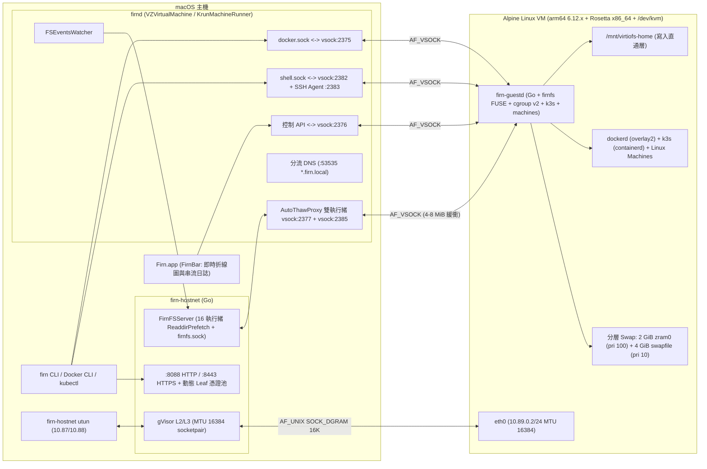

# Firn

[English](./README.md)

**Firn** 是一套開源、輕量級的 macOS Docker、Kubernetes 與 Linux VM 執行環境，以 Swift 與 Go 原生建構於 Apple `Virtualization.framework`（`VZVirtualMachine`）、`virtio-vsock`、Jumbo `virtio-net`（`MTU 16384`）、混合式 `firnfs` 與 Rosetta（`x86_64`）之上。

它全面取代臃腫的桌面容器 Helper：**約 1.5 秒 Guest 開機／2.0 秒 `firn up` 冷啟動**、閒置僅 **0.4% CPU**、**~5,198 req/s HTTP/1.1 Keep-Alive** 與 **~969 MiB/s vsock TCP 轉發**、**`3.05 ms` 本機 `:8443` HTTPS（`~2,982 req/s`）**、**透過 `firnfs`＋macOS `FSEvents` 主動失效在 `78 ms` 內讀完 1,000 個小檔**、**APFS 休眠快照（宿主記憶體 `777 MiB → 21.4 MiB`，VM XPC `0 MiB`）**、**內建單節點 `k3s` Kubernetes（`firn k8s`）**、**多發行版持久化 Linux Machines（`firn machine`）**、**選用 `utun` 容器直連路由**、**可選配開啟 `--nested-kvm`（`/dev/kvm`）**、**`krunkit` Metal／Vulkan GPU 加速**，以及附帶 **CoreGraphics 折線圖與即時日誌串流視窗的原生選單列 App（`Firn.app`）**。

## 為什麼選擇 Firn？

- **休眠零 VM 記憶體佔用與極低待機功耗**：透過 Docker `/events` 長輪詢事件驅動，甦醒閒置待機僅佔 **0.4% CPU**（`761.6 MiB` Footprint）；執行 `firn hibernate`（或設定 `FIRN_HIBERNATE_SECONDS`）可將 VM 狀態快照儲存至 APFS（`saveMachineStateTo`）並卸載 `VZVirtualMachine` XPC 行程，讓宿主總佔用由 **`777.3 MiB` 驟降至 `21.4 MiB`（VM 佔用 `0 MiB`）**，並在下次收到 `docker` 或 `*.firn.local` 流量時無縫自動喚醒。
- **混合式 `firnfs` 加速小檔讀取並維持即時 macOS 同步**：目錄預抓與讀快取透過 `AF_VSOCK:2385`＋`OP_READDIR_PREFETCH`＋**64 MiB LRU 快取**＋macOS **`FSEvents`** 推送失效運作（讀取 1,000 檔僅 **`78.0 ms`**，較 VirtioFS `407.2 ms` 快上 `5.2×`），同時將建立／寫入／刪除操作直接導向 `/mnt/virtiofs-home`（500 檔建寫刪維持 **`383.6 ms`** 高速寫入）。
- **接近線速的迴環轉發與雙執行緒全雙工 `AF_VSOCK`**：雙執行緒 `1 MiB` 阻塞式全雙工轉發加上 `8 MiB` `SO_VM_SOCKETS_BUFFER` 視窗，實測原始 TCP 達 **`921–969 MiB/s`**、PostgreSQL `SELECT 1` RTT **`0.136 ms`**、`19.25 MiB` 批次查詢 **`398 MiB/s`**、HTTP/1.1 Keep-Alive **`5,197.8 req/s`**。
- **獨立 Go `firn-hostnet` L2/L3 網路引擎（不耗盡 `vmenet*`）**：以 connected `AF_UNIX SOCK_DGRAM` `socketpair`（`MTU 16384`）串接 gVisor L2/L3 堆疊與記憶體動態簽發 TLS Leaf 憑證池，將 `https://*.firn.local:8443` 單次請求壓縮至 **`3.05 ms`（`2,981.8 req/s`）**，容器出網提升至 **`1.81 MiB/s`**（即使宿主已有 `251` 個 `vmenet*` 介面亦不受影響）。
- **開箱即用的內建 Kubernetes、Linux Machines、Nested KVM、`utun` 與 Metal GPU**：單指令 `firn k8s enable`（`k3s v1.31.6+k3s1`，安全合併 `~/.kube/config` 並保留原有 `current-context`）、多發行版 `firn machine`（`ubuntu`/`debian`/`alpine`/`arch`/`fedora`）、選配開啟 `--nested-kvm`（`/dev/kvm`）、免 `-p` 衝突 `firn route` 容器子網直連，以及選用 `krunkit` VirtIO-GPU Venus 加速。

## 實測數據（v0.4.0，Apple Silicon Mac）

在同台工作站（**Apple M5 Max**、18 核心 CPU、36.0 GiB 記憶體、macOS 27.2.1、Docker `29.8.2`、Compose `5.5.0`，宿主存在 `251` 個 `vmenet*` 介面）以 [scripts/benchmark.py](./scripts/benchmark.py) 進行可重現實測：

```sh
python3 scripts/benchmark.py --contexts firn        # 執行 Firn v0.4.0 全項基準測試
python3 scripts/benchmark.py --compare              # Firn 與 OrbStack 並排對照
python3 scripts/benchmark.py --json                 # 輸出結構化 JSON 報告
```

> **實測環境說明**：Firn `v0.4.0` 採用預設效能調校組態（`firnfs`、`jumbo-16k`、`diskSync=none`、`nested_kvm=off`）。同機 `Firn v0.3.0` 與 `OrbStack` 對照欄位取自同一台 M5 Max 上相同基準套件之實測紀錄（OrbStack 同時承載 9 個既有背景專案共 62 個容器；於 v0.4.0 測試期間 `top` 量測 OrbStack Helper 為 `60.8–171.3%` CPU 與 `1,696–4,441 MiB` RSS）。

### 第 1–6 類：跨版本與跨執行環境實測對照

| 類別 | 測試指標 | Firn v0.4.0 | Firn v0.3.0 | OrbStack（同機基準） |
| --- | --- | --- | --- | --- |
| **1. 生命週期與 CLI** | `docker version`（5 次中位數） | **`21.26 ms`** | `28.3 ms` | `22.5 ms` |
| | `docker run --rm alpine:3.21 true`（5 次中位數） | **`379.75 ms`** | `401.1 ms` | `477.6 ms` |
| | `docker run --rm --entrypoint true postgres:18-alpine`（5 次中位數） | `460.64 ms` | **`384.5 ms`** | `408.4 ms` |
| | 3 服務 Compose 熱啟動 `up -d --wait`（`postgres` + `valkey` + `mailpit`） | `2,391.66 ms` | `2,627.1 ms` | **`2,072.9 ms`** |
| | 3 服務 Compose 卸除 `down -v --remove-orphans` | `1,582.06 ms` | `4,422.3 ms` | **`825.5 ms`** |
| **2. 具名 Volume I/O** | 循序寫入 256 MiB（`dd ... bs=1M count=256 conv=fsync`） | **`1,814.6 MiB/s`**（`141.1 ms`） | `709.8 MiB/s`（`360.7 ms`） | `1,724.3 MiB/s`（`148.5 ms`） |
| | 循序讀取 256 MiB（`dd`，寫後 page-cache 命中） | `3,728.4 MiB/s`（`68.7 ms`） | `3,949.5 MiB/s`（`64.8 ms`） | **`4,913.7 MiB/s`**（`52.1 ms`） |
| | 小檔突發讀寫（`1,000 × 4 KiB` 建立 + 寫入 + `fsync` + 刪除） | **`836.4 ms`（`1,195.6 ops/s`）** | `1,131.4 ms`（`883.8 ops/s`） | `1,654.9 ms`（`604.3 ops/s`） |
| **3. 宿主共享檔案系統** | 1,000 檔目錄走訪（`find /work -type f`，首次冷 / 3 次中位數） | `849.5 ms` 冷 / `441.1 ms` 中位數 | `445.0 ms` 冷 / `472.1 ms` 中位數 | `587.9 ms` 冷 / **`393.9 ms` 中位數** |
| | 讀取全部 1,000 個檔案（容器內耗時 / 總耗時） | `78.0 ms`（總計 `409.7 ms`） | `407.2 ms`（總計 `891.9 ms`） | **`35.9 ms`**（總計 `371.0 ms`） |
| | 建立 + 寫入 + 刪除 `500 × 4 KiB` 檔案（容器內耗時 / 總耗時） | `383.6 ms`（總計 `759.6 ms`） | `405.7 ms`（總計 `822.6 ms`） | **`140.7 ms`**（總計 `616.8 ms`） |
| **4. 宿主 ↔ 容器網路** | 原始 TCP 128 MiB 宿主 → 容器 | `921.4 MiB/s`（`138.9 ms`） | `418.3 MiB/s`（`306.0 ms`） | **`2,360.3 MiB/s`**（`54.2 ms`） |
| | 原始 TCP 128 MiB 容器 → 宿主 | `969.0 MiB/s`（`132.1 ms`） | `213.4 MiB/s`（`599.9 ms`） | **`4,172.3 MiB/s`**（`30.7 ms`） |
| | HTTP/1.1 Keep-Alive（500 次請求，並行 16，Mailpit `/api/v1/info`） | **`5,197.8 req/s`**（`p50 2.63 ms`） | `2,514.0 req/s`（`p50 5.70 ms`） | `2,197.1 req/s`（`p50 6.07 ms`） |
| | HTTP/1.1 逐次新建連線（500 次請求，並行 16，Mailpit `/api/v1/info`） | **`4,061.7 req/s`**（`p50 3.65 ms`） | `1,283.0 req/s`（`p50 10.21 ms`） | `2,506.7 req/s`（`p50 5.36 ms`） |
| | 本機 HTTPS `https://mailpit.<stack>.firn.local:8443/api/v1/info` | **`HTTP 200`（`3.05 ms`**, **`2,981.8 req/s`** `c=16`） | `HTTP 200`（`104.4 ms`） | — |
| | PostgreSQL `200x SELECT 1` RTT（平均 / p50 / p95） | **`0.136 / 0.132 / 0.166 ms`** | `0.292 / 0.285 / 0.400 ms` | `0.179 / 0.156 / 0.346 ms` |
| | PostgreSQL `19.25 MiB` 批次查詢（`20,185 × 1,000 B`，3 次中位數） | **`398.3 MiB/s`**（`48.34 ms`） | `213.1 MiB/s`（`90.3 ms`） | `251.9 MiB/s`（`76.4 ms`） |
| **5. 對外 HTTPS 出網** | `alpine:3.21` 無代理 HTTPS 下載（宿主存在 `251` 個 `vmenet*`） | **`HTTP 200`**（`1.81 MiB/s`, `0.258s`, jumbo `eth0`） | `HTTP 200`（`0.45 MiB/s`, `1.04s`） | **`HTTP 200`**（`1.83 MiB/s`, `0.25s`） |
| **6. 映像檔建置** | `docker build --no-cache`（`FROM alpine:3.21`，500 個小檔） | **`338.07 ms`** | `464.5 ms` | `2,180.0 ms`（慢 `6.4×`） |

### 第 7 類與 v0.4.0 新功能實測

| 測試指標 | 實測結果（v0.4.0） |
| --- | --- |
| 乾淨關機（`firn down`） | **`835.82 ms`**（`0.84s`） |
| 冷啟動（`firn up` 總耗時 / Guest `[firn-init] ready`） | **`1,998.22 ms`** 總計（Daemon `1,703.3 ms`）/ **`1.49s`** Guest 開機時間 |
| 閒置宿主佔用（`top`，0 容器待機） | **`0.4%` CPU**、**`761.6 MiB`** Footprint（`firnd 29.0 MiB` + `VM 732.6 MiB`） |
| 休眠（`firn hibernate`，APFS `saveMachineStateTo`） | 宿主 Footprint **`777.3 MiB → 21.4 MiB`**（**VM XPC `0 MiB`**），狀態檔 `176.0 MiB`，收到 `docker ps` 時無縫喚醒 |
| 同時執行 3 組雙容器專案（`valkey` + `mailpit`，共 6 容器）活躍記憶體 | `96.35 MiB`（`zram0` `0.02 MiB`） |
| 冷凍並回收 3 組專案（`firn freeze <stack> --reclaim`） | `96.35 MiB → 16.49 MiB`（**釋放 `82.9%`**；`45.02 MiB` swap 壓縮為 **`4.98 MiB`** 存於 `zram0`，CPU `1.5%`） |
| 目標優先 Auto-Thaw（冷凍狀態 Valkey `PING` / HTTPS `:8443`） | **`55.46 ms` TCP** / **`34.58 ms` HTTPS**（確認 `pausedCount = 0`；`guestThaw 25.55 ms`、`hostThaw 26.85 ms`） |
| 內建 Kubernetes（`firn k8s enable`） | `k3s v1.31.6+k3s1` 於 `127.0.0.1:6443` 就緒（`Ready`），安全合併 kubeconfig 並保留原 `current-context` |
| 多發行版 Linux Machines（`firn machine create testbox --distro alpine`） | 自動分配 `10.87.0.2` 與 `testbox.firn.local`、互動 PTY Shell、共享宿主 `$HOME` |
| 選配 Nested KVM（`firn up --nested-kvm`） | Guest 內開放 `/dev/kvm`（`crw-rw-rw- 1 root kvm`） |

## 系統架構



## 先決條件

- macOS 14+（`--nested-kvm` 需 macOS 15+）與支援 `Virtualization.framework` 的 Mac（建議 Apple Silicon）
- Xcode Command Line Tools（`swift`）
- Go 工具鏈（版本對齊 `guest/firn-guestd/go.mod` 與 `host/firn-hostnet/go.mod`）
- Docker CLI 與 Compose v2（`docker`），以及初次組裝 Alpine rootfs 映像檔所需的 builder context（`BUILD_DOCKER_CONTEXT`）
- 選用：`kubectl`（用於 `firn k8s`）與 `krunkit`（`brew tap libkrun/krun && brew install krunkit`，用於 `--backend krun --gpu` Metal／Venus Vulkan 加速）

## 快速開始

```sh
# 編譯 Alpine 核心／rootfs、firn-guestd、firn-hostnet、firn CLI、firnd 與 Firn.app
make build

# 啟動 Firn VM（註冊 'firn' Docker context，不會覆寫原本的預設 context）
build/firn up

# 執行容器、Linux Machines 或內建 Kubernetes
docker --context firn ps
build/firn machine create dev --distro ubuntu && build/firn machine shell dev
build/firn k8s enable && kubectl --context firn get nodes

# 或安全切換為預設 context（隨時可用 `firn context restore` 還原）
build/firn context use
```

## CLI 指令一覽

| 指令 | 說明 |
| --- | --- |
| `firn up [--cpus N] [--memory-gib N] [--context NAME] [--backend vz\|krun] [--fs firnfs\|virtiofs] [--disk-sync none\|fsync] [--gpu] [--nested-kvm]` | 啟動或喚醒 VM、同步組態並建立 Docker context |
| `firn down` | 透過 `/poweroff` 執行乾淨關機（停用 `k3s`、`fstrim`、唯讀保護）並停止 `firnd` |
| `firn hibernate [--json]` | 將 VM 狀態儲存於 APFS（`vm-state.vzvmsave`）或停機休眠，釋放 VM XPC 記憶體至 `0 MiB` |
| `firn resume [--json]` | 立即還原休眠中的 VM（收到流量時亦會自動喚醒） |
| `firn status [--json]` | 查看 VM／主機記憶體、CPU%、能力旗標、APFS 稀疏磁碟、DNS／HTTPS、路由與各專案狀態 |
| `firn shell [-- COMMAND...]` | 經由 `vsock:2382` 開啟互動式 PTY Shell（內建 `SSH_AUTH_SOCK` 轉發） |
| `firn k8s <status\|enable [--no-kubeconfig] [--use]\|disable\|reset\|freeze\|thaw\|kubeconfig>` | 管理內建 `k3s` 單節點 Kubernetes 叢集並安全合併 kubeconfig |
| `firn machine <list\|create <name> [--distro D]\|shell <name>\|start\|stop\|delete>` | 管理共享宿主 `$HOME` 的 Ubuntu/Debian/Alpine/Arch/Fedora 持久環境 |
| `firn route <status\|up\|install [--dns]\|uninstall\|dns <status\|on\|off>>` | 管理宿主 `utun` 容器子網直連路由（`10.87.0.0/24`、`10.88.0.0/16`） |
| `firn freeze <project> [--reclaim]` | 使用 `cgroup.freeze` 暫停專案並回收記憶體與釋放快取 |
| `firn thaw <project>` | 手動解凍指定專案（連線進入時也會自動解凍） |
| `firn reclaim [project]` | 回收閒置記憶體頁面而不強制暫停容器 |
| `firn balloon <shrink\|reset>` | 將 VZ Balloon 縮放至 guest 需求量或恢復上限 |
| `firn disk <usage\|trim> [--json]` | 查看 APFS 稀疏碟／`zram0` 用量，或線上執行 `fstrim` 回收空間 |
| `firn dns <status\|install\|uninstall>` | 檢視本機 DNS 紀錄或管理 `/etc/resolver/<domain>`（`sudo`） |
| `firn ca <status\|install\|uninstall>` | 檢視 Firn 本機 Root CA 或寫入 macOS System Keychain（`sudo`） |
| `firn https <status\|install\|uninstall>` | 檢視 `:8443` HTTPS 代理或安裝 `:80`/`:443` `pf` 轉向規則（`sudo`） |
| `firn context <status\|use\|restore>` | 查看、切換或還原預設 Docker context |
| `firn proxy` | 查看自動偵測到的 macOS 代理、VPN、DNS 與 `SSH_AUTH_SOCK` 狀態 |
| `firn gui` | 啟動附帶效能折線圖與串流日誌的 `build/Firn.app`（`FirnBar`）選單列介面 |
| `firn doctor` | 檢查虛擬化、Nested KVM、Metal GPU/`krunkit`、`firn-hostnet`、`k3s`、CA、DNS 與磁碟狀態 |
| `firn autostart <status\|install\|uninstall>` | 管理選用的使用者 LaunchAgent（`~/Library/LaunchAgents/dev.firn.firnd.plist`） |
| `firn upgrade [--check] [--version vX.Y.Z]` | 檢查或下載並驗證 SHA-256 後升級 GitHub Release 版本 |
| `firn bench [--project NAME] [--compare-orbstack]` | 實測冷凍回收與解凍耗時（可選並對照同機 Helper 佔用） |
| `firn logs [--serial\|--daemon\|--hostnet]` | 查看 VM serial console、`firnd` 或 `firn-hostnet` 日誌 |

## 本機網域與 HTTPS（`*.firn.local`)

每個帶開放 TCP 埠的 Compose 容器與 Linux Machine 皆會自動產生網域（`<container>.firn.local`、`<service>.<project>.firn.local`）：

1. 註冊 macOS 分流 DNS（選用）：`sudo build/firn dns install`
2. 信任本機 Root CA 啟用 `https://<service>.<project>.firn.local:8443`（選用）：`sudo build/firn ca install`
3. 啟用免連接埠號 `http://` 與 `https://`（`pf` 轉向 `:80`/`:443`，選用）：`sudo build/firn https install`

## Compose 標籤與系統組態

```yaml
services:
  postgres:
    image: postgres:18-alpine
    labels:
      - "firn.reaper.exempt=true"   # 永不自動冷凍此 Compose 專案

  worker:
    labels:
      - "firn.reaper.idle=300"      # 覆寫閒置秒數（設為 "0" 等同豁免）
```

全域設定儲存於 `~/.firn/config.json`（亦可從 `FirnBar` → **Settings…** 直接修改），並支援環境變數覆寫：

- `FIRN_HOME`（預設 `~/.firn`）、`FIRN_CONTEXT`（預設 `firn`）
- `FIRN_CPUS`（預設 `8`）、`FIRN_MEMORY_GIB`（預設 `8`）、`FIRN_MIN_BALLOON_MIB`（預設 `768`）
- `FIRN_DISK_SYNC`（預設 `none`，可設 `fsync`）、`FIRN_FS_MODE`（預設 `firnfs`，可設 `virtiofs`）
- `FIRN_BACKEND`（預設 `vz`，可設 `krun`）、`FIRN_GPU`（預設 `false`）、`FIRN_NESTED_VIRT`（預設 `false`）
- `FIRN_HIBERNATE_SECONDS`（預設 `0` 停用自動休眠）、`FIRN_IDLE_SECONDS`（預設 `900`）、`FIRN_EXEMPT_PROJECTS`
- `FIRN_DOMAIN`（`firn.local`）、`FIRN_DNS_PORT`（`53535`）、`FIRN_HTTP_PROXY_PORT`（`8088`）、`FIRN_HTTPS_PROXY_PORT`（`8443`）、`FIRN_DIRECT_ROUTE_DNS`（`false`）
- `BUILD_DOCKER_CONTEXT`（`make build`／`guest/build-rootfs.sh` 建置 rootfs 所用之 Docker context）

## 套件分發與 Homebrew

專案隨附 [packaging/homebrew/firn.rb](./packaging/homebrew/firn.rb) Homebrew Formula，以及自動化 [.github/workflows/ci.yml](./.github/workflows/ci.yml) 與 [.github/workflows/release.yml](./.github/workflows/release.yml) 釋出流程。

## 參與貢獻與授權條款

請參閱 [CONTRIBUTING.md](./CONTRIBUTING.md) 與 [SECURITY.md](./SECURITY.md)。本專案採用 [Apache License 2.0](./LICENSE) 開源授權。
