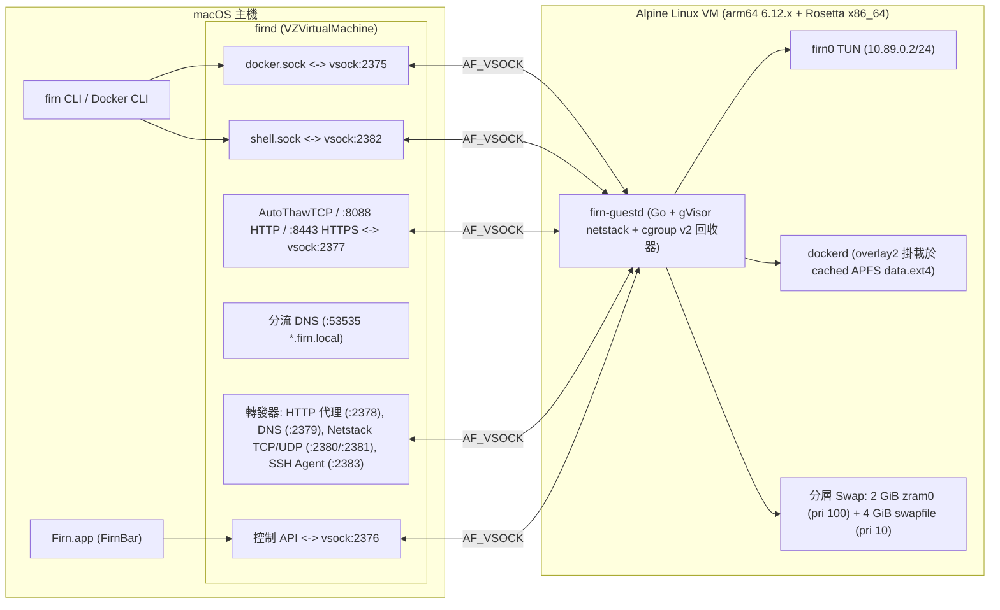

# Firn

[English](./README.md)

**Firn** 是一套開源、輕量級的 macOS Docker Linux VM 執行環境，以 Swift 與 Go 原生建構於 Apple `Virtualization.framework`（`VZVirtualMachine`）、`virtio-vsock`、`virtiofs` 與 Rosetta（`x86_64`）之上。

它致力於以極低閒置資源取代龐大的桌面容器 Helper：約 2.2 秒 Guest 開機（冷啟動 `firn up` 約 2.8 秒）、閒置僅 **0.3% CPU**、**~2.5k req/s HTTP/1.1 Keep-Alive** 與高速 vsock TCP 轉發、**不畏 macOS `vmenet` 數量耗盡與企業 VPN 的 vsock L3/L4 使用者態網路**、**cgroup v2 閒置冷凍與 zram 分層記憶體回收**、**~29 ms TCP / ~88 ms HTTPS 目標優先 Auto-Thaw**、**`https://*.firn.local`** 本機 HTTPS 代理、互動式 **`firn shell`** 與原生 **選單列監控 App（`Firn.app`）**。

## 為什麼選擇 Firn？

- **近乎零待機功耗**：以 Docker `/events` 長輪詢事件驅動，無容器待機時 `firnd` 與 VM 總計僅佔 **0.3% CPU**（RSS `~569 MiB`）。
- **同時保留 10+ worktree 環境不吃光記憶體**：閒置 Compose 專案透過 `cgroup.freeze` 暫停並將冷頁壓縮回收到記憶體 `zram` 與 swapfile（容器 RAM 縮減約 **80–98%**，`zram0` 壓縮率約 `8.8×`）；一旦本機流量打進連接埠或 `*.firn.local`，目標容器毫秒級自動解凍接手連線。
- **容器出網不受 `vmenet*` 上限與 VPN 影響**：除了 `vmnet` 外，`firn-guestd` 透過 `firn0` TUN + gVisor 使用者態網路堆疊走 `AF_VSOCK` 直接由 macOS 主機出網與解析 DNS，天然吃系統路由、企業代理與 split-DNS VPN。
- **高吞吐迴環連線與雙棧支援**：256 KiB 非阻塞 `poll()` 轉發搭配 1 MiB socket buffer 與 `127.0.0.1` + `[::1]` 雙棧監聽，避開 IPv6 fallback 延遲。
- **開箱即用的本機 HTTPS 與 SSH Agent 轉發**：內建主機 Root CA 與 `Network.framework` TLS 反向代理（`:8443`），並自動轉發 macOS `SSH_AUTH_SOCK` 至 `firn shell` 與容器建置流程。

## 實測數據（v0.3.0，同台 Apple Silicon Mac）

在同台工作站（**Apple M5 Max**、18 核心 CPU、36.0 GiB 記憶體、macOS 27.2.1、Docker `29.8.2`、Compose `5.5.0`，宿主存在 `251` 個 `vmenet*` 介面）以相同條件執行 **Firn v0.3.0** 與 **OrbStack** 完整 7 大類實測對照：

可於任何 Mac 上直接重現（僅相依 Python 3 標準函式庫；若系統具備 Go 工具鏈會編譯暫時性靜態輔助程式，所有暫存資源皆以 `firn-bench-*` 命名並於 `finally` 清除，不會更動現有容器與預設 `docker context`）：

```sh
python3 scripts/benchmark.py            # 執行並排對照報表（--compare）
python3 scripts/benchmark.py --json     # 輸出完整結構化 JSON 報告
```

> **實測環境說明**：量測當下 OrbStack 亦同時承載 9 個既有背景 Compose 專案（共 62 個執行中容器，`OrbStack Helper` RSS 為 `3,388–7,395 MiB`、CPU `118–180%`）。Firn 於第 1–6 類測試期間無背景專案，於第 7 類同時啟動 3 組 2 容器基準測試專案。

### 第 1–6 類：跨執行環境對照

| 類別 | 測試指標 | Firn v0.3.0 | OrbStack |
| --- | --- | --- | --- |
| **1. 生命週期與 CLI** | `docker version`（5 次中位數） | `28.3 ms` | **`22.5 ms`** |
| | `docker run --rm alpine:3.21 true`（5 次中位數） | **`401.1 ms`** | `477.6 ms` |
| | `docker run --rm --entrypoint true postgres:18-alpine`（5 次中位數） | **`384.5 ms`** | `408.4 ms` |
| | 3 服務 Compose 熱啟動 `up -d --wait`（`postgres` + `valkey` + `mailpit`） | `2,627.1 ms` | **`2,072.9 ms`** |
| | 3 服務 Compose 卸除 `down -v --remove-orphans` | `4,422.3 ms` | **`825.5 ms`** |
| **2. 具名 Volume I/O** | 循序寫入 256 MiB（`dd ... bs=1M count=256 conv=fsync`） | `709.8 MiB/s`（`360.7 ms`） | **`1,724.3 MiB/s`**（`148.5 ms`） |
| | 循序讀取 256 MiB（`dd`，寫後 page-cache 命中） | `3,949.5 MiB/s`（`64.8 ms`） | **`4,913.7 MiB/s`**（`52.1 ms`） |
| | 小檔突發讀寫（`1,000 × 4 KiB` 建立 + 寫入 + `fsync` + 刪除） | **`1,131.4 ms`（`883.8 ops/s`）** | `1,654.9 ms`（`604.3 ops/s`） |
| **3. Bind Mount / VirtioFS** | 1,000 檔目錄走訪（`find /work -type f`，首次冷 / 3 次中位數） | **`445.0 ms` 冷** / `472.1 ms` 中位數 | `587.9 ms` 冷 / **`393.9 ms` 中位數** |
| | 讀取全部 1,000 個檔案（容器內耗時 / 總耗時） | `407.2 ms`（總計 `891.9 ms`） | **`35.9 ms`**（總計 `371.0 ms`） |
| | 建立 + 寫入 + 刪除 `500 × 4 KiB` 檔案（容器內耗時 / 總耗時） | `405.7 ms`（總計 `822.6 ms`） | **`140.7 ms`**（總計 `616.8 ms`） |
| **4. 宿主 ↔ 容器網路** | 原始 TCP 128 MiB 宿主 → 容器 | `418.3 MiB/s`（`306.0 ms`） | **`2,360.3 MiB/s`**（`54.2 ms`） |
| | 原始 TCP 128 MiB 容器 → 宿主 | `213.4 MiB/s`（`599.9 ms`） | **`4,172.3 MiB/s`**（`30.7 ms`） |
| | HTTP/1.1 Keep-Alive（500 次請求，並行 16，Mailpit `/api/v1/info`） | **`2,514.0 req/s`**（`p50 5.70 ms`） | `2,197.1 req/s`（`p50 6.07 ms`） |
| | HTTP/1.1 逐次新建連線（500 次請求，並行 16，Mailpit `/api/v1/info`） | `1,283.0 req/s`（`p50 10.21 ms`） | **`2,506.7 req/s`**（`p50 5.36 ms`） |
| | 本機 HTTPS `https://mailpit.<stack>.firn.local:8443/api/v1/info`（`curl`） | **`HTTP 200`（`104.4 ms`）** | — |
| | PostgreSQL `200x SELECT 1` RTT（平均 / p50 / p95） | `0.292 / 0.285 / 0.400 ms` | **`0.179 / 0.156 / 0.346 ms`** |
| | PostgreSQL `19.25 MiB` 批次查詢（`20,185 × 1,000 B`，3 次中位數） | `213.1 MiB/s`（`90.3 ms`） | **`251.9 MiB/s`**（`76.4 ms`） |
| **5. 對外 HTTPS 出網** | `alpine:3.21` 無代理 HTTPS 下載（宿主存在 `251` 個 `vmenet*`） | **`HTTP 200`**（`0.45 MiB/s`, `1.04s`, `firn0`） | **`HTTP 200`**（`1.83 MiB/s`, `0.25s`） |
| **6. 映像檔建置** | `docker build --no-cache`（`FROM alpine:3.21`，500 個小檔） | **`464.5 ms`** | `2,180.0 ms`（慢 `4.7×`） |

### 第 7 類：Firn VM 生命週期、多專案記憶體回收與 Auto-Thaw

| 測試指標 | 實測結果 |
| --- | --- |
| 乾淨關機（`firn down`） | **`1,074.4 ms`**（`1.07s`） |
| 冷啟動（`firn up` 總耗時 / Guest `[firn-init] ready`） | **`2,832.0 ms`** 總計（Daemon `2,532.5 ms`）/ **`2.19s`** Guest 開機時間 |
| 閒置宿主佔用（`top -l 2 -s 5`，0 容器待機） | **`0.3%` CPU**、**`769.6 MiB`** Footprint（`firnd 23.9 MiB` + `VM 745.7 MiB`）、**`569.2 MiB`** RSS |
| 同機 OrbStack 快照（9 專案 / 62 容器） | Helper **`118.1–180.3%` CPU**、**`3,388.2–7,395.4 MiB` RSS** |
| 同時執行 3 組雙容器專案（`valkey:9.1.3-alpine` + `mailpit:v1.31.0`，共 6 容器）活躍記憶體 | `95.99 MiB`（`zram0` `0.02 MiB`） |
| 冷凍並回收 3 組專案（`firn freeze <stack> --reclaim`） | `95.99 MiB → 19.24 MiB`（**釋放 `80.0%`**；`42.20 MiB` swap 壓縮為 **`4.78 MiB`** 存於 `zram0`，宿主 CPU **`0.6%`**） |
| 目標優先 TCP Auto-Thaw（冷凍狀態直連 Valkey `PING` → `+PONG`） | **`28.75 ms`**（確認 `pausedCount = 0`） |
| HTTPS Auto-Thaw（冷凍狀態請求 `https://mailpit.<stack>.firn.local:8443/`） | **`88.17 ms`**（`HTTP 200`，確認 `pausedCount = 0`） |
| `firn bench --project <stack> --compare-orbstack` | 冷凍 `100.32 ms`、Guest 解凍 `41.21 ms`、宿主解凍 RTT `42.81 ms`、Balloon `8.00 GiB → 1.23 GiB` |

## 系統架構



## 先決條件

- macOS 14+ 與支援 `Virtualization.framework` 的 Mac（建議 Apple Silicon）
- Xcode Command Line Tools（`swift`）
- Go 工具鏈（版本對齊 `guest/firn-guestd/go.mod`，用於跨編譯 `linux/arm64`）
- Docker CLI 與 Compose v2（`docker`），以及初次組裝 Alpine rootfs 映像檔所需的 builder context（`BUILD_DOCKER_CONTEXT`）

## 快速開始

```sh
# 編譯 Alpine 核心／rootfs、firn-guestd、firn CLI、firnd 與 Firn.app
make build

# 啟動 Firn VM（註冊 'firn' Docker context，不會覆寫原本的預設 context）
build/firn up

# 指定使用 Firn context
docker --context firn ps

# 或安全切換為預設 context（隨時可用 `firn context restore` 還原）
build/firn context use

# 實測容器走 vsock netstack 出網 + 進入互動式 Linux Shell
docker --context firn run --rm alpine:3.21 sh -c 'apk update && apk add curl && curl -I https://example.com'
build/firn shell
```

## CLI 指令一覽

| 指令 | 說明 |
| --- | --- |
| `firn up [--cpus N] [--memory-gib N] [--context NAME]` | 啟動 VM、同步組態並建立 Docker context |
| `firn down` | 透過 `/poweroff` 執行乾淨關機（`fstrim`、卸載與唯讀保護）並停止 `firnd` |
| `firn status [--json]` | 查看 VM／主機記憶體、APFS 稀疏磁碟空間、DNS／HTTPS 與各專案狀態 |
| `firn shell [-- COMMAND...]` | 經由 `vsock:2382` 開啟互動式 PTY Shell（內建 `SSH_AUTH_SOCK` 轉發） |
| `firn freeze <project> [--reclaim]` | 使用 `cgroup.freeze` 暫停專案並回收記憶體與釋放快取 |
| `firn thaw <project>` | 手動解凍指定專案（連線進入時也會自動解凍） |
| `firn reclaim [project]` | 回收閒置記憶體頁面而不強制暫停容器 |
| `firn balloon <shrink\|reset>` | 將 VZ Balloon 縮放至 guest 需求量或恢復上限 |
| `firn disk <usage\|trim> [--json]` | 查看 APFS 稀疏碟／`zram0` 用量，或線上執行 `fstrim` 回收空間 |
| `firn dns <status\|install\|uninstall>` | 檢視本機 DNS 紀錄或管理 `/etc/resolver/<domain>`（`sudo`） |
| `firn ca <status\|install\|uninstall>` | 檢視 Firn 本機 Root CA 或寫入 macOS System Keychain（`sudo`） |
| `firn https <status\|install\|uninstall>` | 檢視 `:8443` HTTPS 代理或安裝 `:80`/`:443` `pf` 轉向規則（`sudo`） |
| `firn context <status\|use\|restore>` | 查看、切換或還原預設 Docker context |
| `firn proxy` | 查看自動偵測到的 macOS 代理、VPN、DNS 與 `SSH_AUTH_SOCK` 狀態 |
| `firn gui` | 啟動 `build/Firn.app`（`FirnBar`）選單列監控介面 |
| `firn doctor` | 檢查虛擬化支援、Rosetta、簽章權限、CA、DNS、`pf` 與磁碟狀態 |
| `firn autostart <status\|install\|uninstall>` | 管理選用的使用者 LaunchAgent（`~/Library/LaunchAgents/dev.firn.firnd.plist`） |
| `firn bench [--project NAME] [--compare-orbstack]` | 實測冷凍回收與解凍耗時（可選並對照同機 Helper 佔用） |
| `firn logs [--serial\|--daemon]` | 查看 VM serial console 或主機 daemon 日誌 |

## 本機網域與 HTTPS（`*.firn.local`）

每個帶開放 TCP 埠的 Compose 容器皆會自動產生網域：
- `<container>.firn.local`
- `<service>.<project>.firn.local`（`mailpit` 另含 `mail.<project>.firn.local`）

1. 註冊 macOS 分流 DNS（選用）：`sudo build/firn dns install`
2. 信任本機 Root CA 啟用 `https://<service>.<project>.firn.local:8443`（選用）：
   ```sh
   sudo build/firn ca install
   ```
3. 啟用免連接埠號 `http://` 與 `https://`（透過 `pf` 將 loopback `:80`/`:443` 導向 Firn 代理，選用）：
   ```sh
   sudo build/firn https install
   ```

## Compose 標籤與系統組態

可在 `docker-compose.yml` 針對單一服務細調自動冷凍行為：

```yaml
services:
  postgres:
    image: postgres:18-alpine
    labels:
      - "firn.reaper.exempt=true"   # 永不自動冷凍此 Compose 專案

  worker:
    labels:
      - "firn.reaper.idle=300"      # 覆寫閒置秒數（設為 "0" 等同豁免）
```

全域設定儲存於 `~/.firn/config.json`（亦可從 `FirnBar` → **Settings…** 直接修改），並支援環境變數覆寫：

- `FIRN_HOME`（預設 `~/.firn`）
- `FIRN_CONTEXT`（預設 `firn`）
- `FIRN_CPUS`（預設 `8`）
- `FIRN_MEMORY_GIB`（預設 `8`）
- `FIRN_MIN_BALLOON_MIB`（預設 `768`）
- `FIRN_DOMAIN`（預設 `firn.local`）
- `FIRN_DNS_PORT`（預設 `53535`）
- `FIRN_HTTP_PROXY_PORT`（預設 `8088`）
- `FIRN_HTTPS_PROXY_PORT`（預設 `8443`）
- `FIRN_IDLE_SECONDS`（預設 `900`，`0` 代表停用全域自動冷凍）
- `FIRN_EXEMPT_PROJECTS`（逗號分隔之豁免 Compose 專案名稱，預設為空）
- `BUILD_DOCKER_CONTEXT`（`make build`／`guest/build-rootfs.sh` 建置 rootfs 所用之 Docker context）

## 參與貢獻與授權條款

請參閱 [CONTRIBUTING.md](./CONTRIBUTING.md) 與 [SECURITY.md](./SECURITY.md)。本專案採用 [Apache License 2.0](./LICENSE) 開源授權。
