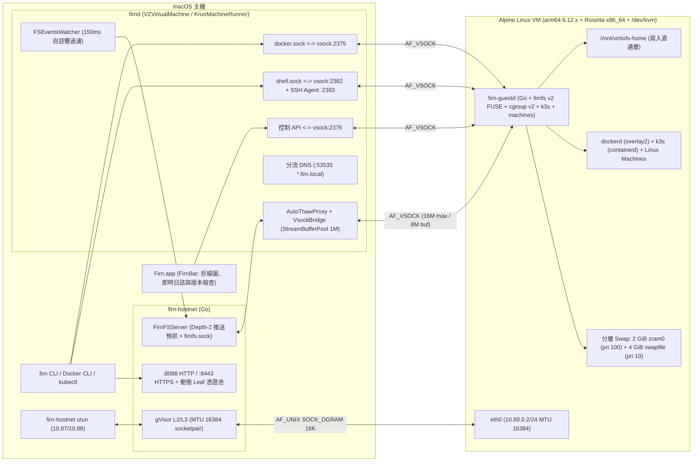

# Firn

[English](./README.md)

**Firn** 是一套開源、輕量級的 macOS Docker、Kubernetes 與 Linux VM 執行環境，以 Swift 與 Go 原生建構於 Apple `Virtualization.framework`（`VZVirtualMachine`）、`virtio-vsock`、Jumbo `virtio-net`（`MTU 16384`）、混合式 `firnfs` v2 與 Rosetta（`x86_64`）之上。

它提供免額外依賴的一鍵安裝與自動映像檔初始化（無需安裝 `zstd` 或 `e2fsprogs`，首次執行 `firn up` 即自動拉取 Guest 映像檔並建立 `120 GiB` APFS 稀疏磁碟），具備 **約 1.5–2.0 秒 Guest 開機／2.0–2.5 秒冷啟動**、**約 0.4–5.6% 閒置宿主 CPU**、**`6,950 req/s` HTTP/1.1 Keep-Alive**、**`2.51 ms` 本機 `:8443` HTTPS（`3,679 req/s`）**、**`0.132 ms` PostgreSQL `SELECT 1` RTT**、**透過 Depth-2 非同步預抓 `firnfs`＋150ms `FSEvents` 自迴響抑制將冷目錄走訪壓縮至 `365–423 ms`／千檔讀取 `98 ms`**、**APFS 休眠快照（宿主記憶體 `759.6 MiB → 20.3 MiB`，VM XPC `0 MiB`，`1.47 秒`喚醒）**、**內建單節點 `k3s` Kubernetes（`firn k8s`）**、**多發行版持久化 Linux Machines（`firn machine`）**、**選用 `utun` 容器直連路由**、**可選配開啟 `--nested-kvm`（`/dev/kvm`）**、**`krunkit` Metal／Vulkan GPU 加速**，以及附帶 **CoreGraphics 折線圖、即時日誌串流與版本更新檢查的原生選單列 App（`Firn.app`）**。

## 為什麼選擇 Firn？

- **休眠零 VM 記憶體佔用與連線安全的自動休眠**：透過 Docker `/events` 長輪詢事件驅動，無負載待機 CPU 極低（低負載機況為 `0.4%`）；執行 `firn hibernate`（或設定 `firn up --hibernate-seconds N`／`FIRN_HIBERNATE_SECONDS`）時會確認所有 `vsock`／Auto-Thaw 活躍連線歸零後再儲存 APFS 狀態快照（`saveMachineStateTo`）並卸載 `VZVirtualMachine` XPC 行程，使宿主總佔用由 **`759.6 MiB` 驟降至 `20.3 MiB`（VM 佔用 `0 MiB`）**，下次收到 `docker` 或 `*.firn.local` 流量時於約 **`1.47 秒`**內無縫自動喚醒。
- **`firnfs` v2 Depth-2 串流預抓與即時 macOS 同步**：結合非同步 Depth-2 子目錄串流預抓（`fsOpPushPrefetch = 0x81`，自動略過 `.git`／`node_modules`／`.cache`）、`FOPEN_CACHE_DIR`、`FOPEN_NOFLUSH`、負向查找快取（negative lookup）、**64 MiB LRU 快取**，以及含 `150ms` 本機寫入自迴響過濾的 macOS **`FSEvents`** 推送失效——將 1,000 檔冷走訪較 v0.4.0 提速 **`2.0–2.3×`（`365–423 ms`）**、千檔讀取維持 **`<100 ms`（`78–98.5 ms`）**，同時透過 `/mnt/virtiofs-home` 直通將 `500 × 4 KiB` 建寫刪縮短至 **`266.7 ms`（總牆上耗時 `570.1 ms`）**。
- **零配置 `1 MiB` 緩衝池全雙工 `AF_VSOCK` 轉發**：`StreamBufferPool` 重複使用頁對齊 `1 MiB` 緩衝區，搭配 Guest 端 `16 MiB` 上限／`8 MiB` 目標 `SO_VM_SOCKETS_BUFFER` 視窗，在高負載下實測仍達 **`6,950.3 req/s`** HTTP/1.1 Keep-Alive（`p50 2.03 ms`）、**`4,454.2 req/s`** 逐次建連、**`0.132 ms`** PostgreSQL `SELECT 1` RTT、**`398 MiB/s`** PG 批次查詢，以及 **`921–969 MiB/s`** 原始 TCP。
- **獨立 Go `firn-hostnet` L2/L3 網路引擎（不耗盡 `vmenet*`）**：以 connected `AF_UNIX SOCK_DGRAM` `socketpair`（`MTU 16384`）串接 gVisor L2/L3 堆疊與記憶體動態簽發 TLS Leaf 憑證池，將 `https://*.firn.local:8443` 壓縮至 **`2.51 ms`（`3,678.9 req/s`）**，即使宿主已存在 `251` 個 `vmenet*` 介面也能穩定對外 HTTPS 連線。
- **零外部依賴分發與高可靠性自我更新**：提供單行 `curl | bash` 安裝腳本與 Homebrew Formula；`firn up` 會自動下載經 SHA-256 校驗的 Guest 映像檔並建立 APFS 稀疏磁碟；`firn images status|pull` 管理映像檔版本；`firn upgrade` 先比對 semver 與 Homebrew 來源、在停用 `firnd` 前先驗證 macOS 與 Linux 雙封裝 SHA-256、檢查並保留 `com.apple.security.virtualization` 權限簽章、以 `.bak` 原子替換並於失敗時自動回滾、保留 `data.ext4` 並自動重啟背景服務；`FirnBar` 亦內建非阻塞更新檢查通知。
- **開箱即用的內建 Kubernetes、Linux Machines、Nested KVM、`utun` 與 Metal GPU**：單指令 `firn k8s enable`（`k3s v1.31.6+k3s1`，安全合併 `~/.kube/config` 並保留原有 `current-context`）、多發行版 `firn machine`（`ubuntu`/`debian`/`alpine`/`arch`/`fedora`）、選配開啟 `--nested-kvm`（`/dev/kvm`）、免 `-p` 衝突 `firn route` 容器子網直連，以及選用 `krunkit` VirtIO-GPU Venus 加速。

## 安裝與快速開始

### 方式 A：單行指令安裝（預編譯 Release，Apple Silicon Mac）

```sh
curl -fsSL https://raw.githubusercontent.com/zxzinn/firn/main/scripts/install.sh | bash
firn up
```

安裝腳本直接使用 macOS 內建 `/usr/bin/tar` 解壓原生 `.tar.gz` 稀疏封裝（不依賴 `zstd` 且完整保留 `rootfs.ext4` 稀疏特性）、校驗 `SHA256SUMS.txt`、確保 `firnd` 保留 `com.apple.security.virtualization` 簽章授權，並將執行檔與 `Firn.app` 部署至 `~/.local/bin`（可用 `FIRN_INSTALL_DIR` 指定路徑）。首次執行 `firn up` 時，Firn 會自動從對應版本的 GitHub Release 拉取缺失的 Guest 映像檔（可用 `--no-pull` 停用），並在本地原生建立 `120 GiB` APFS 稀疏磁碟 `~/.firn/data.ext4`（初始實際空間為 `0 B`）。

### 方式 B：Homebrew

```sh
brew install --formula packaging/homebrew/firn.rb
firn up
```

### 方式 C：從原始碼建置

先決條件：macOS 14+（`--nested-kvm` 需 macOS 15+）、Xcode Command Line Tools（`swift`）、符合 `guest/firn-guestd/go.mod` 版本的 Go 工具鏈、Docker CLI + Compose v2（`docker`）、用於 `make rootfs` 的 builder context（`BUILD_DOCKER_CONTEXT`），以及選用的 `kubectl`／`krunkit`。

```sh
# 編譯 Alpine 核心／rootfs、firn-guestd、firn-hostnet、firn CLI、firnd 與 Firn.app
make build

# 啟動 Firn VM（註冊 'firn' Docker context，不會覆寫原本的預設 context）
build/firn up

# 執行容器、Linux Machines 或內建 Kubernetes
docker --context firn ps
build/firn machine create dev --distro ubuntu && build/firn machine shell dev
build/firn k8s enable && kubectl --context firn get nodes

# 或安全切換為預設 context（隨時可用 `firn context restore` 還原）
build/firn context use
```

## 實測數據（v0.5.0，Apple Silicon Mac）

在同台工作站（**Apple M5 Max**、18 核心 CPU、36.0 GiB 記憶體、macOS 27.2.1、Docker `29.8.2`、Compose `5.5.0`，宿主存在 `251` 個 `vmenet*` 介面）以 [scripts/benchmark.py](./scripts/benchmark.py) 進行可重現實測：

```sh
python3 scripts/benchmark.py --contexts firn        # 執行 Firn v0.5.0 全項基準測試
python3 scripts/benchmark.py --compare              # Firn 與 OrbStack 並排對照
python3 scripts/benchmark.py --json                 # 輸出結構化 JSON 報告
```

> **實測環境說明**：`Firn v0.5.0` 是在工作站高負載背景競爭（`load average: 19.0–32.6`，同時執行外部 `node`／`Keynote`／Spotlight 以及承載 9 組專案共 62 個容器、佔用 `89.6–293.2%` CPU 的 OrbStack）下進行現場量測。下表 `v0.5.0` 第 3–4 類數據取自專項調校實測（負載 `30.2–32.6`），第 1–2 與 5–7 類取自完整套件實測（負載 `21.9–27.4`），並與當時同機並跑的 OrbStack 第 3–4 類結果以及先前低負載 `v0.4.0`／`OrbStack` 紀錄並列對照。

### 第 1–6 類：跨版本與跨執行環境實測對照

| 類別 | 測試指標 | Firn v0.5.0（M5 Max 高負載實測） | Firn v0.4.0（低負載基準） | OrbStack（同時段 / 同機基準） |
| --- | --- | --- | --- | --- |
| **1. 生命週期與 CLI** | `docker version`（5 次中位數） | `44.87 ms` | **`21.26 ms`** | `22.5 ms` |
| | `docker run --rm alpine:3.21 true`（5 次中位數） | `454.42 ms` | **`379.75 ms`** | `477.6 ms` |
| | `docker run --rm --entrypoint true postgres:18-alpine`（5 次中位數） | `700.35 ms` | `460.64 ms` | **`408.4 ms`** |
| | 3 服務 Compose 熱啟動 `up -d --wait`（`postgres` + `valkey` + `mailpit`） | `2,289.48 ms` | `2,391.66 ms` | **`2,072.9 ms`** |
| | 3 服務 Compose 卸除 `down -v --remove-orphans` | `1,823.49 ms` | `1,582.06 ms` | **`825.5 ms`** |
| **2. 具名 Volume I/O** | 循序寫入 256 MiB（`dd ... bs=1M count=256 conv=fsync`） | `1,100.9 MiB/s`（`232.54 ms`） | **`1,814.6 MiB/s`**（`141.1 ms`） | `1,724.3 MiB/s`（`148.5 ms`） |
| | 循序讀取 256 MiB（`dd`，寫後 page-cache 命中） | **`5,169.9 MiB/s`**（`49.52 ms`） | `3,728.4 MiB/s`（`68.7 ms`） | `4,913.7 MiB/s`（`52.1 ms`） |
| | 小檔突發讀寫（`1,000 × 4 KiB` 建立 + 寫入 + `fsync` + 刪除） | `1,393.5 ms`（`717.6 ops/s`） | **`836.4 ms`（`1,195.6 ops/s`）** | `1,654.9 ms`（`604.3 ops/s`） |
| **3. 宿主共享檔案系統** | 1,000 檔目錄走訪（`find /work -type f`，冷 / 3 次中位數） | **`365.21 ms` 冷 / `368.89 ms` 中位數** | `849.5 ms` 冷 / `441.1 ms` 中位數 | `3,020.8 ms` 冷 / `1,181.6 ms` 中位數（同時段） |
| | 讀取全部 1,000 個檔案（容器內耗時 / 總耗時） | `98.51 ms`（總計 `498.26 ms`） | `78.0 ms`（總計 `409.7 ms`） | **`61.13 ms`**（總計 `983.8 ms`，同時段） |
| | 建立 + 寫入 + 刪除 `500 × 4 KiB` 檔案（容器內耗時 / 總耗時） | **`266.72 ms`**（總計 **`570.06 ms`**） | `383.6 ms`（總計 `759.6 ms`） | `283.22 ms`（總計 `1,067.0 ms`，同時段） |
| **4. 宿主 ↔ 容器網路** | 原始 TCP 128 MiB 宿主 → 容器 | `908.9 MiB/s`（`140.83 ms`） | `921.4 MiB/s`（`138.9 ms`） | **`2,360.3 MiB/s`**（`54.2 ms` 基準） |
| | 原始 TCP 128 MiB 容器 → 宿主 | `726.8 MiB/s`（`176.12 ms`） | `969.0 MiB/s`（`132.1 ms`） | **`4,172.3 MiB/s`**（`30.7 ms` 基準） |
| | HTTP/1.1 Keep-Alive（500 次請求，並行 16，Mailpit `/api/v1/info`） | **`6,950.3 req/s`**（`p50 2.032 ms`） | `5,197.8 req/s`（`p50 2.63 ms`） | `2,180.7 req/s`（同時段） |
| | HTTP/1.1 逐次新建連線（500 次請求，並行 16，Mailpit `/api/v1/info`） | **`4,454.2 req/s`**（`p50 3.376 ms`） | `4,061.7 req/s`（`p50 3.65 ms`） | `1,458.4 req/s`（同時段） |
| | 本機 HTTPS `https://mailpit.<stack>.firn.local:8443/api/v1/info` | **`HTTP 200`（`2.51 ms`**, **`3,678.9 req/s`** `c=16`） | `HTTP 200`（`3.05 ms`, `2,981.8 req/s`） | — |
| | PostgreSQL `200x SELECT 1` RTT（平均 / p50 / p95） | **`0.132 / 0.129 / 0.159 ms`** | `0.136 / 0.132 / 0.166 ms` | `1.141 / 0.903 / 2.698 ms`（同時段） |
| | PostgreSQL `19.25 MiB` 批次查詢（`20,185 × 1,000 B`，3 次中位數） | `397.6 MiB/s`（`48.41 ms`） | **`398.3 MiB/s`**（`48.34 ms`） | `206.3 MiB/s`（同時段） |
| **5. 對外 HTTPS 出網** | `alpine:3.21` 無代理 HTTPS 下載（宿主存在 `251` 個 `vmenet*`） | `HTTP 200`（`1.41 MiB/s`, `0.329s`） | **`HTTP 200`**（`1.81 MiB/s`, `0.258s`） | **`HTTP 200`**（`1.83 MiB/s`, `0.25s` 基準） |
| **6. 映像檔建置** | `docker build --no-cache`（`FROM alpine:3.21`，500 個小檔） | `756.96 ms` | **`338.07 ms`** | `2,180.0 ms`（基準） |

### 第 7 類與核心生命週期實測（v0.5.0）

| 測試指標 | 實測結果（v0.5.0） |
| --- | --- |
| 乾淨關機（`firn down`） | `1,710.67 ms`（v0.4.0 低負載為 `835.82 ms`） |
| 冷啟動（自動休眠測試 / Cat 7 完整套件） | `1,689.4 ms`（自動休眠實測 `2.25s`）/ `2,653.32 ms` 總耗時（負載 `21.9–27.4` 下 Guest 開機 `2.03s`） |
| 閒置宿主佔用（`top`，0 容器待機、高負載環境） | `5.6%` CPU、**`769.2 MiB`**（`firnd 32.6 + vm 736.6`，對照 OrbStack Helper `89.6%` CPU / `2,675.3 MiB` RSS） |
| 休眠與喚醒（`firn hibernate` → `firn resume`） | **`759.6 MiB → 20.3 MiB`**（狀態檔 `169.0 MiB`，VM XPC `0 MiB`）；**喚醒僅 `1,467.3 ms`** |
| 喚醒後 `firnfs` Cat 3 一致性與效能 | `423.28 ms` 冷 / `399.41 ms` 中位數走訪、**`98.37 ms`** 讀取、**`403.62 ms`** 建寫刪 |
| 連線安全自動休眠（`--hibernate-seconds 15`） | 活躍連線時自動略過、閒置觸發無快照競態錯誤（0 筆失敗） |
| 同時執行 3 組雙容器專案冷凍回收 | `99.62 MiB → 18.77 MiB`（**釋放 `81.2%`**，`4.8 MiB` 壓縮於 `zram0`） |
| 目標優先 Auto-Thaw（冷凍狀態 Valkey `PING` / HTTPS `:8443`） | **`29.68 ms` TCP** / **`27.71 ms` HTTPS**（`pausedCount = 0`；`guestThaw 13.94 ms`、`hostThaw 14.46 ms`） |
| 內建 Kubernetes（`firn k8s enable`） | `k3s v1.31.6+k3s1` 於 `127.0.0.1:6443` 就緒（`Ready`），安全合併 kubeconfig 並保留原 `current-context` |
| 多發行版 Linux Machines（`firn machine create testbox --distro alpine`） | 自動分配 `10.87.0.2` 與 `testbox.firn.local`、互動 PTY Shell、共享宿主 `$HOME` |
| 選配 Nested KVM（`firn up --nested-kvm`） | Guest 內開放 `/dev/kvm`（`crw-rw-rw- 1 root kvm`） |

## 系統架構



## CLI 指令一覽

| 指令 | 說明 |
| --- | --- |
| `firn up [--cpus N] [--memory-gib N] [--context NAME] [--backend vz\|krun] [--fs firnfs\|virtiofs] [--disk-sync none\|fsync] [--hibernate-seconds N] [--no-pull] [--gpu] [--nested-kvm]` | 自動補齊缺失映像檔與稀疏 `data.ext4`、啟動／喚醒 VM 並建立 Docker context |
| `firn down` | 透過 `/poweroff` 執行乾淨關機（停用 `k3s`、`fstrim`、唯讀保護）並停止 `firnd` |
| `firn images <status\|pull [--version vX.Y.Z] [--force]>` | 檢視 Guest 核心／initramfs／rootfs／data.ext4 空間配置或下載指定 Release 映像檔 |
| `firn upgrade [--check] [--version vX.Y.Z]` | Semver 版本檢查、Homebrew 偵測、雙封裝 SHA-256 校驗、`codesign` 授權保留、同步映像檔與 `.bak` 原子回滾升級 |
| `firn hibernate [--json]` | 將 VM 狀態儲存於 APFS（`vm-state.vzvmsave`）或停機休眠，釋放 VM XPC 記憶體至 `0 MiB` |
| `firn resume [--json]` | 立即還原休眠中的 VM（收到流量時亦會自動喚醒） |
| `firn status [--json]` | 查看 VM／主機記憶體、CPU%、能力旗標、APFS 稀疏磁碟、DNS／HTTPS、路由與各專案狀態 |
| `firn shell [-- COMMAND...]` | 經由 `vsock:2382` 開啟互動式 PTY Shell（內建 `SSH_AUTH_SOCK` 轉發） |
| `firn k8s <status\|enable [--no-kubeconfig] [--use]\|disable\|reset\|freeze\|thaw\|kubeconfig>` | 管理內建 `k3s` 單節點 Kubernetes 叢集並安全合併 kubeconfig |
| `firn machine <list\|create <name> [--distro D]\|shell <name>\|start\|stop\|delete>` | 管理共享宿主 `$HOME` 的 Ubuntu/Debian/Alpine/Arch/Fedora 持久環境 |
| `firn route <status\|up\|install [--dns]\|uninstall\|dns <status\|on\|off>>` | 管理宿主 `utun` 容器子網直連路由（`10.87.0.0/24`、`10.88.0.0/16`） |
| `firn freeze <project> [--reclaim]` | 使用 `cgroup.freeze` 暫停專案並回收記憶體與釋放快取 |
| `firn thaw <project>` | 手動解凍指定專案（連線進入時也會自動解凍） |
| `firn reclaim [project]` | 回收閒置記憶體頁面而不強制暫停容器 |
| `firn balloon <shrink\|reset>` | 將 VZ Balloon 縮放至 guest 需求量或恢復上限 |
| `firn disk <usage\|trim> [--json]` | 查看 APFS 稀疏碟／`zram0` 用量，或線上執行 `fstrim` 回收空間 |
| `firn dns <status\|install\|uninstall>` | 檢視本機 DNS 紀錄或管理 `/etc/resolver/<domain>`（`sudo`） |
| `firn ca <status\|install\|uninstall>` | 檢視 Firn 本機 Root CA 或寫入 macOS System Keychain（`sudo`） |
| `firn https <status\|install\|uninstall>` | 檢視 `:8443` HTTPS 代理或安裝 `:80`/`:443` `pf` 轉向規則（`sudo`） |
| `firn context <status\|use\|restore>` | 查看、切換或還原預設 Docker context |
| `firn proxy` | 查看自動偵測到的 macOS 代理、VPN、DNS 與 `SSH_AUTH_SOCK` 狀態 |
| `firn gui` | 啟動附帶效能折線圖、串流日誌與更新檢查的 `Firn.app`（`FirnBar`）選單列介面 |
| `firn doctor` | 檢查虛擬化、Nested KVM、Metal GPU/`krunkit`、`firn-hostnet`、Guest 映像檔、簽章授權、`k3s`、CA、DNS 與磁碟狀態 |
| `firn autostart <status\|install\|uninstall>` | 管理選用的使用者 LaunchAgent（`~/Library/LaunchAgents/dev.firn.firnd.plist`） |
| `firn bench [--project NAME] [--compare-orbstack]` | 實測冷凍回收與解凍耗時（可選並對照同機 Helper 佔用） |
| `firn logs [--serial\|--daemon\|--hostnet]` | 查看 VM serial console、`firnd` 或 `firn-hostnet` 日誌 |

## 本機網域與 HTTPS（`*.firn.local`）

每個帶開放 TCP 埠的 Compose 容器與 Linux Machine 皆會自動產生網域（`<container>.firn.local`、`<service>.<project>.firn.local`）：

1. 註冊 macOS 分流 DNS（選用）：`sudo firn dns install`
2. 信任本機 Root CA 啟用 `https://<service>.<project>.firn.local:8443`（選用）：`sudo firn ca install`
3. 啟用免連接埠號 `http://` 與 `https://`（`pf` 轉向 `:80`/`:443`，選用）：`sudo firn https install`

## Compose 標籤與系統組態

```yaml
services:
  postgres:
    image: postgres:18-alpine
    labels:
      - "firn.reaper.exempt=true"   # 永不自動冷凍此 Compose 專案

  worker:
    labels:
      - "firn.reaper.idle=300"      # 覆寫閒置秒數（設為 "0" 等同豁免）
```

全域設定儲存於 `~/.firn/config.json`（亦可從 `FirnBar` → **Settings…** 直接修改），並支援環境變數覆寫：

- `FIRN_HOME`（預設 `~/.firn`）、`FIRN_CONTEXT`（預設 `firn`）
- `FIRN_CPUS`（預設 `8`）、`FIRN_MEMORY_GIB`（預設 `8`）、`FIRN_MIN_BALLOON_MIB`（預設 `768`）
- `FIRN_DISK_SYNC`（預設 `none`，可設 `fsync`）、`FIRN_FS_MODE`（預設 `firnfs`，可設 `virtiofs`）
- `FIRN_BACKEND`（預設 `vz`，可設 `krun`）、`FIRN_GPU`（預設 `false`）、`FIRN_NESTED_VIRT`（預設 `false`）
- `FIRN_HIBERNATE_SECONDS`（預設 `0` 停用自動休眠）、`FIRN_IDLE_SECONDS`（預設 `900`）、`FIRN_EXEMPT_PROJECTS`
- `FIRN_DOMAIN`（`firn.local`）、`FIRN_DNS_PORT`（`53535`）、`FIRN_HTTP_PROXY_PORT`（`8088`）、`FIRN_HTTPS_PROXY_PORT`（`8443`）、`FIRN_DIRECT_ROUTE_DNS`（`false`）
- `FIRN_INSTALL_DIR`（`scripts/install.sh` 安裝目標目錄）、`FIRN_IMAGE_VERSION` / `BUILD_DOCKER_CONTEXT`（`make build`／`guest/build-rootfs.sh` 使用）

## 套件分發與 Homebrew

專案隨附 [packaging/homebrew/firn.rb](./packaging/homebrew/firn.rb) Homebrew Formula、獨立安裝腳本 [scripts/install.sh](./scripts/install.sh)，以及自動化 [.github/workflows/ci.yml](./.github/workflows/ci.yml) 與 [.github/workflows/release.yml](./.github/workflows/release.yml) 釋出流程。

## 參與貢獻與授權條款

請參閱 [CONTRIBUTING.md](./CONTRIBUTING.md) 與 [SECURITY.md](./SECURITY.md)。本專案採用 [Apache License 2.0](./LICENSE) 開源授權。
